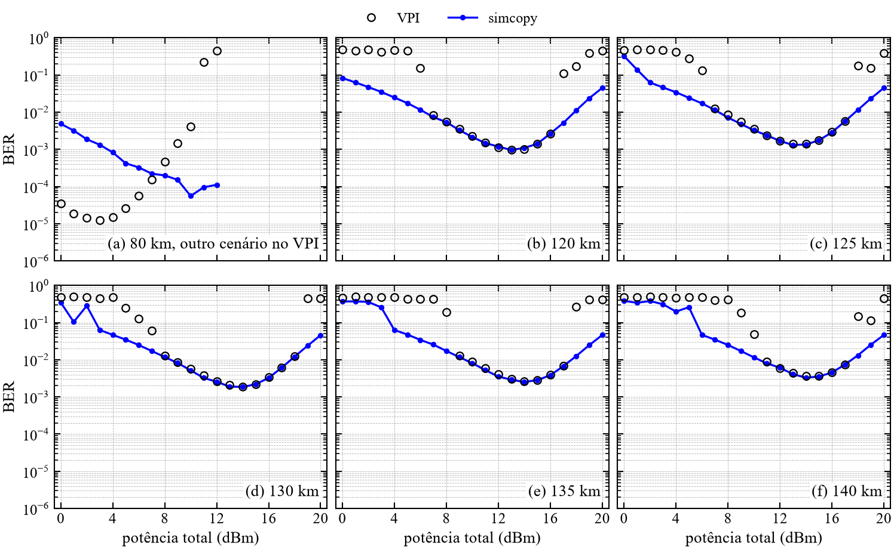
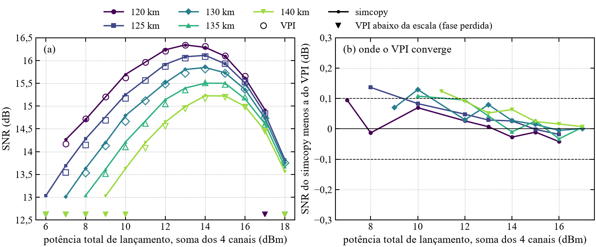
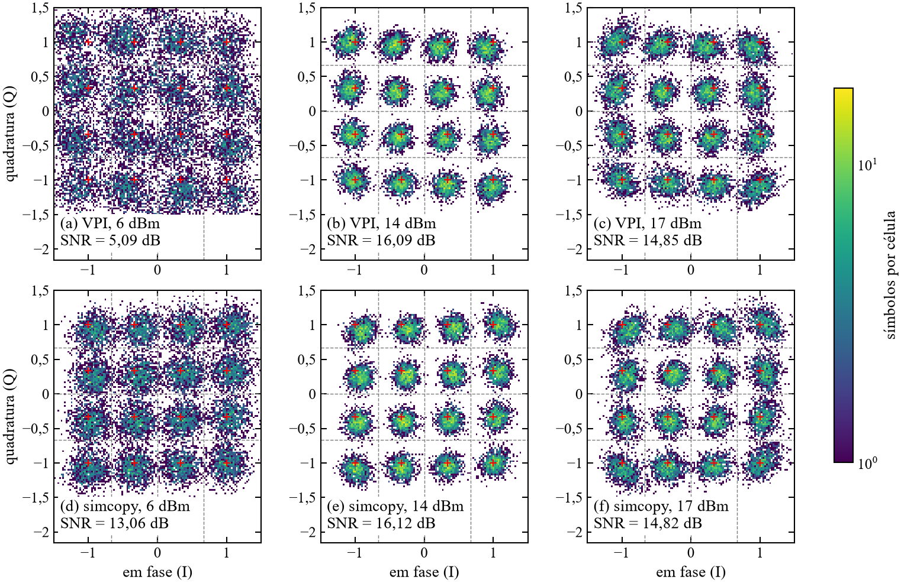

# Comparação do simcopy com o VPI: 4 canais DP-16QAM (2026-11-14)

O simcopy reproduz as constelações do VPI no cenário de 4 canais DP-16QAM a 59,84 GBd, em 125 e
140 km: a SNR ponto a ponto fica de 0,03 a 0,16 dB acima da do VPI, e os três termos do ajuste
(ruído do receptor, piso e não linearidade) ficam dentro das tolerâncias do roteiro do pacote. Dois
parâmetros que o arquivo do VPI não traz foram fixados a partir dos próprios dados (seção 3), e a
análise achou um provável erro nas tabelas de BER do grupo (seção 5).

Atualização de 2026-11-16 (seção 9): com o DSP cego e a janela de fase de 21, a SNR fica de 0,21
a 0,33 dB acima da do VPI, e a queda de baixa potência do VPI aparece no simcopy 1 dB abaixo. (A
janela do VPI é 43, não 21: `docs/replicacao_vpi_diario.md`.)

Segunda atualização de 2026-11-16 (seção 10): o sinal do desbalanço de 5° foi corrigido (−5°, com
excursão de 0,51) e a comparação foi refeita em 120, 125, 130, 135 e 140 km. A imagem e o
deslocamento passaram a bater com o VPI, com e sem os 5°. A SNR fica de 0,07 a 0,30 dB acima com
símbolos conhecidos e de 0,19 a 0,44 dB acima com o DSP cego. **As seções 3, 4 e 9 foram rodadas
com +5° e 0,47 e ficam como registro: os números que valem são os da seção 10.**

Terceira atualização (2026-11-17, `docs/replicacao_vpi_diario.md`): com o skew de uma amostra
(1,044 ps, medido nos dados) e a janela de fase de 43 símbolos (a do VPI), a SNR do receptor cego
fica de −0,04 a +0,14 dB da do VPI nos cinco comprimentos, com média de +0,04 dB.

Fontes: `reference/vpi/parametros_vtmu.md` (parâmetros do VPI), as
constelações exportadas pelo grupo (`dados4canais`, fora do repositório) e o roteiro do pacote
(`docs/roadmap.md`, tarefa 8, e `docs/decisoes.md`).

---

## 1. O que foi comparado

**Cenário** (`examples/400zr_4ch_75ghz.yaml`): 4 canais DP-16QAM, 75 GHz, mux gaussiano de ordem 3
(70 GHz, 3 dB), booster controlado por potência (figura de ruído de 5 dB), um trecho de fibra padrão
com PMD, filtro do canal, receptor coerente com oscilador local a 500 MHz. O canal medido é o de
índice 2 (o `Ch_X2/Ch_Y2` do VPI).

**Dados do VPI:** constelações do canal 2 depois do DSP, com $2^{18}$ símbolos por polarização,
potências de 0 a 20 dBm, em 125, 130, 135 e 140 km, mais uma constelação de referência com os
símbolos transmitidos.

**Simcopy:** $2^{14}$ símbolos por polarização, 16 amostras por símbolo, uma realização (semente 0).
Com $2^{14}$ símbolos sobram 15346 por polarização depois das guardas, o que dá erro estatístico da
ordem de 0,05 dB na SNR. Os $2^{18}$ do VPI custariam 16 vezes mais tempo e memória.

Nas seções 1 a 8 o DSP do simcopy usa os símbolos transmitidos conhecidos (decisão do pacote). O do
VPI é cego. O DSP cego do simcopy está na seção 9. A comparação só vale na faixa de potências em que o DSP do VPI converge: 8 a 17 dBm em 125 km, 11 a
17 dBm em 140 km.

---

## 2. Método

Nas constelações do VPI e nos símbolos equalizados do simcopy, o mesmo ajuste de mínimos quadrados:

$$x = g\,a + h\,a^* + c + \text{ruído}$$

com $a$ os símbolos transmitidos. Dele saem:

| Grandeza | O que mede |
|---|---|
| $\lvert h/g\rvert$ | imagem de quadratura: desbalanço de fase do modulador IQ |
| $\lvert c/g\rvert/\mathrm{rms}(a)$ | deslocamento constante: vazamento de portadora pela extinção finita dos MZM |
| SNR do resto | o que sobra sem a imagem e sem o deslocamento |
| SNR total | contra $g\,a$, como a medida do simcopy |
| SER | taxa de erro de símbolo, que não depende do mapeamento de bits |

Depois, o modelo de três termos do pacote, com $P$ a potência da varredura em mW:

$$\frac{1}{\mathrm{SNR}} = \frac{A}{P} + B + C\,P^2$$

$A$ é o ruído do receptor, $B$ o piso independente da potência e $C$ a não linearidade da fibra.

A SNR e a SER saem direto das constelações. Não passam pela conversão de BER em SNR, que dependia do
mapeamento (`GrayMapping = No` no VPI).

---

## 3. Dois parâmetros fixados pelos dados

O arquivo do VPI não traz estes dois valores. Os dois foram escolhidos olhando os dados do VPI, e
por isso o que eles ajustam não conta como verificação.

**Potência da varredura: soma dos 4 canais (D-22).** **[Fato medido]** Com a potência do VPI lida
como total, o termo $C$ do simcopy fica a 5 % do VPI. Lida como potência por canal, a potência por
canal seria 6 dB maior e $C$ ficaria 16 vezes maior. É a terceira evidência a favor de "total",
depois das duas do pacote (`docs/arquitetura.md`, seção 14.16). No simcopy `booster.output_power` é
por canal, então 13 dBm do VPI são 13 − 6,02 dBm por canal.

**Excursão do acionamento do modulador (`tx.drive_depth` = 0,47, dúvida 56).** **[Calibrado]** As
constelações do VPI têm um deslocamento constante de 0,077 do valor rms, igual em todas as potências
e nas duas distâncias. No modelo do simcopy esse deslocamento vem da extinção de 30 dB dos MZM
internos e depende da excursão: 0,52 dá 0,070 e 0,47 dá 0,077. O valor 0,47 foi escolhido para
reproduzir o deslocamento. Com ele o pico do pulso chega a cerca de 0,9 do MZM, sem ceifamento.

---

## 4. Resultados

### 4.1 Os três termos

| | $A$ | $B$ (piso) | $C$ |
|---|---|---|---|
| 125 km, VPI | 0,1455 | 0,01528 (18,16 dB) | 5,70e-6 |
| 125 km, simcopy | 0,1416 | 0,01493 (18,26 dB) | 5,42e-6 |
| diferença | −0,12 dB | −0,10 dB | −0,22 dB |
| 140 km, VPI | 0,2916 | 0,01508 (18,22 dB) | 5,95e-6 |
| 140 km, simcopy | 0,2926 | 0,01470 (18,33 dB) | 5,61e-6 |
| diferença | +0,01 dB | −0,11 dB | −0,25 dB |

Janelas do ajuste: 8 a 16 dBm em 125 km, 11 a 17 dBm em 140 km. Resíduo rms do ajuste abaixo de
0,02 dB nos quatro casos. As tolerâncias do roteiro do pacote eram ±0,5 dB em $A$ e em $B$ e ±1 dB
na penalidade não linear.

### 4.2 Ponto a ponto

| L [km] | P [dBm] | SNR VPI [dB] | SNR simcopy [dB] | SER VPI | SER simcopy |
|---|---|---|---|---|---|
| 125 | 8 | 14,14 | 14,26 | 3,35e-2 | 2,90e-2 |
| 125 | 10 | 15,17 | 15,27 | 1,43e-2 | 1,28e-2 |
| 125 | 12 | 15,87 | 15,97 | 6,87e-3 | 5,38e-3 |
| 125 | 13 | 16,05 | 16,18 | 5,70e-3 | 5,21e-3 |
| 125 | 14 | 16,09 | 16,21 | 5,61e-3 | 4,82e-3 |
| 125 | 15 | 15,93 | 16,05 | 7,15e-3 | 6,48e-3 |
| 125 | 16 | 15,53 | 15,67 | 1,17e-2 | 1,11e-2 |
| 125 | 17 | 14,84 | 15,00 | 2,28e-2 | 1,95e-2 |
| 140 | 11 | 14,07 | 14,13 | 3,49e-2 | 3,21e-2 |
| 140 | 12 | 14,56 | 14,59 | 2,39e-2 | 2,29e-2 |
| 140 | 13 | 14,94 | 14,99 | 1,76e-2 | 1,64e-2 |
| 140 | 14 | 15,16 | 15,24 | 1,45e-2 | 1,24e-2 |
| 140 | 15 | 15,20 | 15,30 | 1,45e-2 | 1,27e-2 |
| 140 | 16 | 14,98 | 15,12 | 1,85e-2 | 1,61e-2 |
| 140 | 17 | 14,45 | 14,59 | 2,93e-2 | 2,52e-2 |

A potência ótima é a mesma: 14 dBm em 125 km e 15 dBm em 140 km. A SER do simcopy fica de 4 a 22 %
abaixo da do VPI, o que acompanha a SNR 0,1 dB maior.

### 4.3 Imagem e deslocamento

| | VPI | simcopy |
|---|---|---|
| imagem $\lvert h/g\rvert$ | 0,0444 | 0,042 a 0,043 |
| 5° de desbalanço de fase, $\tan 2{,}5°$ | 0,0437 | |
| deslocamento | 0,0762 a 0,0770 | 0,0767 a 0,0776 (calibrado) |

A imagem é uma verificação independente do modelo do modulador IQ: sai dos 5° do arquivo, sem
ajuste.

### 4.4 O filtro casado

**[Fato: documento do VPI, seção 8]** A cadeia de DSP do VPI não tem um filtro casado separado:
depois da compensação de dispersão vem o equalizador MIMO de 7 coeficientes (`NTaps = 7`,
`InitTaps = RRC`). O cenário do simcopy segue isso (`rx.dsp.matched_filter: false`).

Com o filtro casado ligado (`reference/vpi/comparacao/simcopy_filtro_casado.json`, rodado com
excursão de 0,52), o ruído do receptor cai: $A$ = 0,0951, 1,85 dB abaixo do VPI. A conta fechada do
ruído térmico e de disparo dos oito fotodiodos, na banda do filtro casado, dá $A$ = 0,0875. Sem o
filtro casado, o simcopy sobe para $A$ = 0,1416, a 0,12 dB do VPI: o equalizador curto no lugar do
filtro casado explica a diferença.

Isso também responde em parte à dúvida 26: com a densidade do ruído térmico lida como unilateral
($\sigma_T^2 = i_T^2\,\Delta f$), o termo $A$ fecha com o VPI em 0,1 dB.

---

## 5. O que a análise dos dados do VPI mostrou

1. **As tabelas de BER e SER do grupo usam o dobro do total.**
   `resultado_SER_por_polarizacao_4canais_125km_canal2.csv` traz `Total_X = 524288`, mas cada
   arquivo de constelação tem 262144 pontos. Contando os erros de símbolo a 13 dBm em X, achei 1487
   em 262144 (5,7e-3). A tabela tem 1497 em 524288 (2,9e-3). A BER da tabela é exatamente a SER da
   tabela dividida por 4. Se o total estiver dobrado, a SER e a BER das tabelas estão pela metade.
   **Precisa de confirmação do grupo.**
2. **Os alvos antigos do pacote vieram dessas tabelas.** `reference/vpi/ajuste_abc.py` do pacote
   dava $A$ = 0,1186 e $B$ = 0,01224 (piso de 19,12 dB) a partir da BER. Direto das constelações,
   $A$ = 0,1455 e $B$ = 0,01528 (18,16 dB). $C$ quase não muda (5,67e-6 contra 5,70e-6).
3. **O piso tem três partes.** Em 125 km, $B$ = 0,01528 = 0,00197 (imagem) + 0,00593
   (deslocamento) + 0,00735 (resto). O vazamento de portadora pesa três vezes mais que o
   desbalanço de fase. O pacote atribuía o piso ao desbalanço, ao skew e à banda S21.
4. **A constelação de referência não é a saída do transmissor.** Ela tem SNR de 21,97 dB contra a
   grade ideal, sem imagem (0,0002) e sem deslocamento. Serve para saber os símbolos transmitidos.
   Não sei como foi gerada.
5. **Sem os 5°** (`dados_4_canais_sem_5_graus`, 120 km), a imagem some (0,0004) e o deslocamento
   continua (0,070 a 0,072), como o modelo prevê.

---

## 6. Diferenças de modelo que ficam

- **DSP.** Nas seções 1 a 8 o do simcopy usa os símbolos conhecidos, e o do VPI é cego. Fora da
  janela convergida o VPI perde o sincronismo e o simcopy não. Com o DSP cego do simcopy: seção 9.
- **FWM.** O VPI tem `FWM = No`. O SSFM do campo agregado inclui a mistura de quatro ondas. Pode
  ser parte dos 5 % de diferença em $C$, mas o sinal é o contrário do esperado (o simcopy tem menos
  não linearidade), então não é a explicação.
- **Sequência de bits.** PRBS de ordem 7 no VPI, bits aleatórios no simcopy.
- **Inclinação da dispersão.** O VPI tem. O simcopy passou a ter em 2026-11-16, e as rodadas das
  seções 1 a 8 são de antes. O efeito medido foi de −0,02 dB a 13 dBm.
- **ADC de 12 bits.** Só existe no modo cego (seção 9). Com 12 bits o ruído de quantização fica 53
  dB abaixo do sinal.
- **Estatística.** Uma realização de PMD e de ruído, com $2^{14}$ símbolos, contra $2^{18}$ do VPI.
- **Frequências absolutas.** No YAML o centro da banda está em 193,7 THz e o canal 2 em +37,5 GHz.
  No VPI o canal 2 está em 193,7 THz. A diferença de 37,5 GHz na frequência absoluta não muda
  $\beta_2$ de forma mensurável.

---

## 7. Como reproduzir

```
python scripts/compara_vpi.py vpi "<pasta>/dados4canais/extraido" -o reference/vpi/comparacao/vpi.json
python scripts/compara_vpi.py simular --lengths 125 --powers 8 10 12 13 14 15 16 17 -o final_125.json
python scripts/compara_vpi.py simular --lengths 140 --powers 11 12 13 14 15 16 17 -o final_140.json
python scripts/compara_vpi.py ajuste reference/vpi/comparacao/vpi.json reference/vpi/comparacao/simcopy.json
python scripts/compara_vpi.py figura reference/vpi/comparacao/*.json -o reference/vpi/comparacao/comparacao.png
```

Cada ponto leva de 30 s (8 dBm) a 200 s (17 dBm) com $2^{14}$ símbolos. Em
`reference/vpi/comparacao/` ficam o resumo das constelações do VPI (`vpi.json`), os resultados do
simcopy (`simcopy.json`, 125 e 140 km juntos) e a figura. Os arquivos originais do grupo (2,7 GB)
não vão para o repositório.

---

## 8. Pendências

- ~~Confirmar com o grupo o total das tabelas de BER e SER (seção 5, item 1).~~ Conferido em
  2026-11-16 (dúvida 60): a tabela conta as componentes I e Q em separado, então o total não está
  dobrado e a "SER" dela é por componente. A BER dela continua sendo a metade da real.
- ~~Confirmar que `PowerdBm` é a soma dos 4 canais (seção 3).~~ Confirmado pelo Gabriel em
  2026-11-16 (dúvida 61).
- Saber como a constelação de referência do VPI foi gerada (seção 5, item 4).
- ~~Rodar 130 e 135 km, e algumas sementes, para ter barra de erro.~~ Feito: seções 9.2 e 10.
- O resto do piso (0,0071 no simcopy, 0,0073 no VPI) ainda não foi decomposto.
- Do DSP cego (seção 9.5): rodar com $2^{18}$ símbolos, e entender os 0,2 a 0,3 dB a favor do
  simcopy e a queda do VPI em 18 dBm.

---

## 9. DSP cego (2026-11-16)

O simcopy ganhou o receptor cego (`rx.dsp.mode: blind`; `docs/sistema_coerente.md`, seção 12.1): ADC
de 12 bits, espaço de Stokes, equalizador de módulo constante, desvio de frequência pela quarta
potência, busca cega de fase conjunta nas duas polarizações e ajuste dirigido por decisão. Nenhuma
etapa usa os símbolos transmitidos. Só a medida usa, para casar polarização, atraso e giro de 90°.
Esta seção repete a comparação com ele.

O cenário e a estatística são os das seções anteriores ($2^{14}$ símbolos, semente 0), com duas
diferenças: o YAML passou a ter a inclinação da dispersão do VPI (`dispersion_slope`, −0,02 dB na
SNR a 13 dBm) e o ADC de 12 bits entra na cadeia. A busca cega de fase rodou com duas janelas: 21
símbolos, que eu supunha ser a do VPI (`NPreSymbols = 21`), e 81.

**Correção (2026-11-17):** a janela de fase do VPI não é 21. `NPreSymbols = 21` são os símbolos
de cada lado, e a janela é de 43, medida nas constelações do VPI (`docs/replicacao_vpi_diario.md`,
etapa A). Onde esta seção diz "janela do VPI (21)", leia "janela de 21". Com a de 43 o termo $C$
do receptor cego fecha com o do VPI (diário, testes 1 e 2).

Figura: `reference/vpi/comparacao/comparacao_cego.png`.

### 9.1 Na faixa em que o VPI converge

SNR em dB:

| L [km] | P [dBm] | VPI | simcopy, símbolos conhecidos | simcopy cego, janela 21 | simcopy cego, janela 81 |
|---|---|---|---|---|---|
| 125 | 7 | 13,54 | | 13,78 | 13,74 |
| 125 | 8 | 14,14 | 14,26 | 14,39 | 14,33 |
| 125 | 10 | 15,17 | 15,27 | 15,40 | 15,30 |
| 125 | 12 | 15,87 | 15,97 | 16,11 | 15,96 |
| 125 | 13 | 16,05 | 16,18 | 16,28 | 16,09 |
| 125 | 14 | 16,09 | 16,21 | 16,32 | 16,07 |
| 125 | 15 | 15,93 | 16,05 | 16,20 | 15,86 |
| 125 | 16 | 15,53 | 15,67 | 15,82 | 15,38 |
| 125 | 17 | 14,84 | 15,00 | 15,17 | 14,64 |
| 140 | 11 | 14,07 | 14,13 | 14,30 | 14,22 |
| 140 | 12 | 14,56 | 14,59 | 14,80 | 14,69 |
| 140 | 13 | 14,94 | 14,99 | 15,15 | 15,01 |
| 140 | 14 | 15,16 | 15,24 | 15,43 | 15,22 |
| 140 | 15 | 15,20 | 15,30 | 15,46 | 15,18 |
| 140 | 16 | 14,98 | 15,12 | 15,28 | 14,89 |
| 140 | 17 | 14,45 | 14,59 | 14,77 | 14,28 |

- **Com a janela do VPI (21), o receptor cego fica de 0,21 a 0,33 dB acima do VPI** nos 16 pontos.
  A diferença quase não muda com a potência nem com a distância.
- **Com a janela de 81**, fica de 0,20 dB acima (potência baixa) a 0,20 dB abaixo (potência alta).
- A potência ótima não muda: 14 dBm em 125 km e 15 dBm em 140 km (com a janela de 81, 13 e 14 dBm
  empatam em 125 km).
- Nenhum salto de fase em nenhum destes pontos.

Os três termos, nas janelas de ajuste da seção 4 (8 a 16 dBm em 125 km, 11 a 17 dBm em 140 km):

| | $A$ | $B$ (piso) | $C$ |
|---|---|---|---|
| 125 km, VPI | 0,1455 | 0,01528 (18,16 dB) | 5,70e-6 |
| 125 km, cego, janela 21 | 0,1358 | 0,01471 (18,32 dB) | 5,07e-6 |
| diferença | −0,30 dB | −0,17 dB | −0,51 dB |
| 125 km, cego, janela 81 | 0,1355 | 0,01520 (18,18 dB) | 6,52e-6 |
| diferença | −0,31 dB | −0,02 dB | +0,58 dB |
| 140 km, VPI | 0,2916 | 0,01508 (18,22 dB) | 5,95e-6 |
| 140 km, cego, janela 21 | 0,2779 | 0,01429 (18,45 dB) | 5,37e-6 |
| diferença | −0,21 dB | −0,23 dB | −0,45 dB |
| 140 km, cego, janela 81 | 0,2756 | 0,01492 (18,26 dB) | 6,72e-6 |
| diferença | −0,25 dB | −0,05 dB | +0,53 dB |

Resíduo rms dos ajustes abaixo de 0,02 dB. Os três termos ficam dentro das tolerâncias do roteiro
do pacote (±0,5 dB em $A$ e em $B$, ±1 dB na penalidade não linear) com as duas janelas.

**O que a janela muda.** **[Fato medido]** As duas janelas têm o mesmo $A$, e a de 81 tem $C$ 28 %
maior em 125 km (25 % em 140 km). **[Inferência]** A fase não linear que os canais vizinhos impõem
varia mais rápido que 81 símbolos: a janela curta acompanha parte dela, a longa não.

**Por que o cego fica acima do modo com símbolos conhecidos** (0,10 a 0,21 dB com a janela de 21).
**[Inferência]** No modo com símbolos conhecidos a fase é tirada antes do equalizador, em amostras
mais ruidosas, e por polarização. No cego ela é tirada depois do equalizador e com as duas
polarizações juntas.

**Por que fica acima do VPI.** Não sei. **[Hipóteses, não verificadas]** (i) O equalizador do VPI
se adapta por gradiente, símbolo a símbolo, e isso deixa um erro em excesso. O do simcopy refaz os
coeficientes por mínimos quadrados no bloco inteiro. (ii) Algum ruído do receptor do VPI que o
simcopy não tem: $A$ é 0,2 a 0,3 dB menor nos dois modos cegos. No modo com símbolos conhecidos
ficava a 0,1 dB.

### 9.2 Fora da faixa: a queda do VPI

O resumo `vpi.json` cobre de 6 a 18 dBm. Nas pontas a constelação do VPI se perde. SNR em dB, com a
SER entre parênteses onde a medida se perdeu:

| L [km] | P [dBm] | VPI | simcopy cego, janela 21 | simcopy cego, janela 81 |
|---|---|---|---|---|
| 125 | 5 | | 2,62 (0,46), 2 saltos | 12,41 |
| 125 | 6 | 5,09 (0,38) | 13,09 | 13,07 |
| 125 | 7 | 13,54 | 13,78 | 13,74 |
| 125 | 18 | 3,61 (0,52) | 14,16 | 13,56 |
| 125 | 19 | | 12,78 | 12,14 |
| 140 | 9 | 3,85 (0,62) | 3,76 (0,33), 2 saltos | 13,05 |
| 140 | 10 | 9,59 (0,16) | 13,73 | 13,68 |
| 140 | 11 | 14,07 | 14,30 | 14,22 |
| 140 | 18 | 6,50 (0,56) | 13,89 | 13,33 |

Com a janela de 21 e outras oito sementes de ruído, em 125 km:

| P [dBm] | SNR sem salto [dB] | realizações com salto |
|---|---|---|
| 5 | 12,26 a 12,41 | 2 de 9 |
| 6 | 13,03 a 13,11 | 0 de 9 |
| 7 | 13,69 a 13,78 | 0 de 9 |

1. **[Fato medido] A queda de baixa potência do VPI aparece no simcopy quando a janela de fase é a
   do VPI.** A causa no simcopy é a busca cega de fase saltar de um giro de 90° para outro no meio
   do bloco. A medida conta esses saltos (`phase_slips`). É uma propriedade do receptor, não do
   enlace: com a janela de 81 não há salto de 2 a 19 dBm.
2. **A queda do simcopy fica 1 dB abaixo da do VPI:** 5 dBm contra 6 dBm em 125 km, 9 dBm contra 10
   dBm em 140 km. Em SNR: o simcopy salta com 12,3 dB e com 13,05 dB, e não salta com 13,03 a 13,11
   dB em nove realizações. O VPI funciona com 13,52 a 13,54 dB (125 km a 7 dBm, 130 km a 8 dBm, 135
   km a 9 dBm) e falha onde o modelo de três termos dele dá 13,48 dB (140 km a 10 dBm) e 12,85 dB
   (125 km a 6 dBm). **[Inferência]** Duas causas, que não separei: a SNR do simcopy é 0,24 dB
   maior na mesma potência, e o bloco do VPI tem 16 vezes mais símbolos, portanto 16 vezes mais
   chances de saltar.
3. **A queda de alta potência (18 dBm) não foi reproduzida.** Com a janela de 21 o simcopy não
   saltou em 18 dBm (125 e 140 km) nem em 19 dBm (125 km), com uma realização em cada ponto. No
   próprio VPI ela não é sistemática: em 130 km a 18 dBm ele funciona, com 13,75 dB, e em 125 km
   falha onde o modelo dele dá 13,95 dB. **[Inferência]** A fase não linear tem memória, e o limiar
   deixa de depender só da SNR. Fica em aberto.
4. **A janela de 81 troca a queda por uma perda em alta potência:** 0,53 dB a 17 dBm em 125 km
   (14,64 contra 15,17 dB).

### 9.3 Imagem e deslocamento

No modo cego a imagem fica entre 0,042 e 0,044 e o deslocamento entre 0,0766 e 0,0780, como no modo
com símbolos conhecidos e como no VPI (0,0444 e 0,0762 a 0,0770). O receptor cego não tira nenhum
dos dois, e o do VPI também não.

### 9.4 Como reproduzir

```
python scripts/compara_vpi.py simular --lengths 125 --powers 5 6 7 8 10 12 13 14 15 16 17 18 19 --dsp mode=blind phase_window=21 -o cego21_125.json
python scripts/compara_vpi.py simular --lengths 140 --powers 9 10 11 12 13 14 15 16 17 18 --dsp mode=blind phase_window=21 -o cego21_140.json
python scripts/compara_vpi.py simular --lengths 125 --powers 6 7 --seed 3 --dsp mode=blind phase_window=21 -o semente3.json
python scripts/compara_vpi.py ajuste reference/vpi/comparacao/vpi.json reference/vpi/comparacao/simcopy_cego_janela21.json
python scripts/compara_vpi.py figura reference/vpi/comparacao/vpi.json reference/vpi/comparacao/simcopy.json reference/vpi/comparacao/simcopy_cego.json reference/vpi/comparacao/simcopy_cego_janela21.json --lengths 125 140 -o figura.png
```

`--dsp CAMPO=VALOR` troca campos de `rx.dsp` em todos os canais. A varredura grava o JSON depois de
cada ponto. Em `reference/vpi/comparacao/` ficam `simcopy_cego.json` (janela de 81),
`simcopy_cego_janela21.json` e `comparacao_cego.png`. As rodadas das outras sementes não foram
guardadas: os números estão na tabela da seção 9.2.

### 9.5 Pendências

- Rodar com $2^{18}$ símbolos, como o VPI, para separar as duas causas do item 2 da seção 9.2 e
  procurar a queda de 18 dBm. O equalizador adaptativo é um laço em Python e hoje isso leva 16
  vezes mais (`docs/revisao_2026-11-14.md`, ponto 46).
- Entender os 0,2 a 0,3 dB a favor do simcopy. Ajudaria saber como o VPI normaliza o sinal antes
  do equalizador (o passo de 5e-4 de lá não é comparável com o do simcopy) e se o `MMA` dele segue
  adaptando depois de convergir.
- O sinal do desbalanço de 5° foi corrigido depois desta seção: seção 10.

---

## 10. Com o sinal dos 5° corrigido, em cinco comprimentos (2026-11-16)

Resposta do Gabriel à dúvida 64: aplicar −5° e excursão de 0,51, e testar nos outros comprimentos.
O YAML passou a ter `phase_imbalance_deg: -5.0` e `drive_depth: 0.51`. Tudo o que está nas seções 3,
4 e 9 foi rodado com +5° e 0,47, e fica como registro: os números que valem daqui em diante são os
desta seção.

Rodado: 120, 125, 130, 135 e 140 km, com o DSP de símbolos conhecidos e com o DSP cego (janela de
fase de 21, a do VPI), os dois medidos sobre o mesmo sinal propagado. Mais 120 km sem os 5°, para
comparar com `dados_4_canais_sem_5_graus`. Mesma estatística das outras seções ($2^{14}$ símbolos,
semente 0). Arquivos em `reference/vpi/comparacao/sinal_corrigido/`, figura `comparacao.png`.

### 10.1 O sinal: imagem e deslocamento, com e sem os 5°

O VPI tem `PhaseShift = -90+5`: 85° entre os braços do modulador IQ. No simcopy isso é −5°.

| 120 km, 7 a 16 dBm | Imagem $\lvert h/g\rvert$ | Deslocamento |
|---|---|---|
| VPI, com os 5° | 0,0441 a 0,0443 | 0,0767 a 0,0771 |
| simcopy, −5° e 0,51 | 0,0430 a 0,0439 | 0,0757 a 0,0766 |
| VPI, sem os 5° | 0,0002 a 0,0007 | 0,0726 a 0,0730 |
| simcopy, 0° e 0,51 | 0,0008 a 0,0015 | 0,0729 a 0,0737 |

**[Fato medido]** Com um valor só de excursão, o simcopy acompanha o deslocamento do VPI nos dois
conjuntos: ele sobe de 0,073 para 0,077 quando os 5° entram. Com +5° ele descia (de 0,079 para
0,077, com 0,47, sem fibra). Nos outros comprimentos a imagem fica entre 0,0423 e 0,0445 (VPI:
0,0442 a 0,0446) e o deslocamento entre 0,0755 e 0,0766 (VPI: 0,0762 a 0,0770).

### 10.2 SNR nos cinco comprimentos

No ponto de maior SNR de cada comprimento, e a faixa da diferença para o VPI onde ele converge:

| L [km] | Potência ótima [dBm] | VPI [dB] | Símbolos conhecidos [dB] | Cego, janela 21 [dB] | Símbolos conhecidos − VPI | Cego − VPI |
|---|---|---|---|---|---|---|
| 120 | 13 | 16,34 | 16,56 | 16,67 | +0,10 a +0,30 | +0,19 a +0,42 |
| 125 | 14 | 16,09 | 16,30 | 16,44 | +0,13 a +0,29 | +0,31 a +0,43 |
| 130 | 14 | 15,82 | 16,01 | 16,14 | +0,07 a +0,28 | +0,24 a +0,44 |
| 135 | 14 | 15,51 | 15,71 | 15,83 | +0,14 a +0,27 | +0,28 a +0,42 |
| 140 | 15 | 15,20 | 15,39 | 15,55 | +0,09 a +0,25 | +0,27 a +0,43 |

A potência ótima é a mesma do VPI nos cinco. A diferença cresce com a potência: é menor em potência
baixa e maior em potência alta.

Os três termos, com o DSP de símbolos conhecidos (janelas: 7 a 16, 8 a 16, 9 a 17, 10 a 17 e 11 a
17 dBm):

| L [km] | $A$ VPI | $A$ simcopy | $B$ VPI | $B$ simcopy | $C$ VPI | $C$ simcopy |
|---|---|---|---|---|---|---|
| 120 | 0,1150 | 0,1157 (+0,03 dB) | 0,01526 | 0,01414 (−0,33 dB) | 5,67e-6 | 5,29e-6 (−0,30 dB) |
| 125 | 0,1455 | 0,1440 (−0,05 dB) | 0,01528 | 0,01441 (−0,25 dB) | 5,70e-6 | 5,29e-6 (−0,33 dB) |
| 130 | 0,1836 | 0,1871 (+0,08 dB) | 0,01520 | 0,01396 (−0,37 dB) | 5,87e-6 | 5,49e-6 (−0,29 dB) |
| 135 | 0,2319 | 0,2300 (−0,04 dB) | 0,01515 | 0,01412 (−0,31 dB) | 5,90e-6 | 5,51e-6 (−0,30 dB) |
| 140 | 0,2916 | 0,2934 (+0,03 dB) | 0,01508 | 0,01413 (−0,28 dB) | 5,95e-6 | 5,49e-6 (−0,35 dB) |

- **O ruído do receptor ($A$) fecha em ±0,08 dB nos cinco comprimentos.** Ele cresce 4,0 dB de 120
  para 140 km nos dois simuladores, como os 4 dB a mais de perda da fibra pedem.
- **O piso ($B$) do simcopy ficou 0,25 a 0,37 dB abaixo do VPI.** Com +5° e 0,47 ficava 0,10 dB
  abaixo. A causa está na seção 10.3.
- **A não linearidade ($C$) fica 0,29 a 0,35 dB abaixo**, como antes (−0,22 a −0,25 dB).

Com o DSP cego as diferenças são: $A$ de −0,13 a −0,31 dB, $B$ de −0,31 a −0,40 dB e $C$ de −0,54 a
−0,62 dB. Tudo dentro das tolerâncias do roteiro do pacote (±0,5 dB em $A$ e em $B$, ±1 dB na
penalidade não linear).

### 10.3 Por que o piso mudou: o ruído do booster depende da excursão

**[Fato medido]** Trocar só o sinal dos 5° não muda o resto do piso (o que sobra sem a imagem e sem
o deslocamento): em 125 km e 14 dBm, 17,90 dB com +5° e com −5°, os dois com excursão de 0,47, e
18,10 e 18,08 dB com excursão de 0,51. O que muda o resto é a excursão. A inclinação da dispersão
muda a SNR em 0,004 dB nesse ponto.

**[Fato medido]** A excursão muda a potência de saída do transmissor, e com ela o ganho que o
booster precisa ter para chegar à potência da varredura:

| Excursão | Saída de um transmissor | Ganho do booster para 13 dBm | ASE do booster sobre o sinal de um canal |
|---|---|---|---|
| 0,47 | −18,56 dBm | 28,67 dB | 0,00358 |
| 0,51 | −17,84 dBm | 27,96 dB | 0,00304 |

A última coluna é a ASE do booster nas duas polarizações, na banda de 59,84 GHz, dividida pela
potência de um canal. A diferença entre as linhas, 0,00054, é a diferença medida no resto do piso
(0,00711 com 0,47 e 0,00655 com 0,51, em 125 km).

O resto do piso do simcopy, com 0,51, é a soma de três partes:

| Parte | $1/\mathrm{SNR}$ | Como medi |
|---|---|---|
| ASE do booster | 0,0030 | conta acima |
| transmissor (skew, extinção, banda S21, lasers) | 0,0025 | um canal, sem fibra e sem ruído do receptor |
| o que sobra (receptor, DSP, PMD, canais vizinhos) | cerca de 0,001 | diferença |
| total medido | 0,0062 a 0,0066 | ajuste, cinco comprimentos |
| VPI | 0,0072 a 0,0074 | ajuste |

**[Inferência]** A excursão do acionamento, que o arquivo do VPI não traz, decide três coisas de uma
vez: o deslocamento (cai com a excursão), a ASE do booster (cai com o quadrado dela) e parte da
distorção do transmissor. Os dados do VPI com e sem os 5° fixam a excursão pelo deslocamento
(0,51). Para o piso fechar, a ASE do booster teria de ser 0,0039 em vez de 0,0030, o que pede uma
potência de saída do transmissor cerca de 1 dB menor do que a que essa excursão dá no simcopy. As
duas coisas fecham se a perda do transmissor do VPI for cerca de 1 dB maior que a do simcopy, e a
perda de inserção do modulador IQ é justamente a dúvida 59 (o valor de 6 dB é de cada MZM ou do
modulador inteiro?). Não ajustei nada para fechar: seria um segundo parâmetro calibrado.

**O que resolve:** a potência óptica na entrada do booster no VPI (ou na saída de um transmissor).
Com ela a ASE do booster deixa de depender da excursão.

### 10.4 Fora da faixa em que o VPI converge

Com os parâmetros novos o receptor cego do simcopy (janela de 21) não teve salto de fase em nenhum
dos 51 pontos, inclusive nos pontos em que o VPI se perde:

| L [km] | VPI se perde em | simcopy cego no mesmo ponto |
|---|---|---|
| 120 | 6 e 17 dBm | 17 dBm: 15,35 dB, sem salto (6 dBm não rodou) |
| 125 | 6 e 18 dBm | 13,15 e 14,31 dB, sem salto |
| 130 | 7 dBm | 13,11 dB, sem salto |
| 135 | 8 e 18 dBm | 13,15 e 14,14 dB, sem salto |
| 140 | 9, 10 e 18 dBm | 13,12, 13,80 e 14,03 dB, sem salto |

Na seção 9.2, com os parâmetros antigos, ele saltou em 125 km a 5 dBm e em 140 km a 9 dBm. Agora,
com uma realização de $2^{14}$ símbolos por ponto, não saltou com 13,1 dB de SNR em quatro
comprimentos. O VPI, com $2^{18}$ símbolos, se perde abaixo de 13,5 dB. A queda de alta potência
do VPI continua sem aparecer no simcopy. No VPI ela vem em 17 dBm em 120 km, em 18 dBm em 125, 135 e 140 km, e não vem em 130 km.

### 10.5 O que falta do lado do VPI para chegar mais perto

Em ordem do que mais ajudaria:

1. **Potência óptica na entrada do booster** (ou na saída de um transmissor). Fixa a ASE do
   booster, que é quase metade do resto do piso (seção 10.3).
2. **Uma rodada sem fibra** (transmissor ligado direto ao receptor), em três ou quatro potências
   recebidas. Separa o piso do transmissor do ruído do receptor, sem a fibra no meio.
3. **Uma rodada com um canal só**, mesma fibra. Separa a não linearidade do próprio canal da dos
   vizinhos: é onde o $C$ do simcopy fica 0,3 dB abaixo.
4. **Constelações antes do DSP** (na saída do ADC), em um ou dois pontos. Com elas o DSP do simcopy
   roda sobre o sinal do VPI, e a diferença de 0,2 a 0,4 dB do receptor cego deixa de se misturar
   com a do enlace.
5. **Parâmetros que o documento não traz:** a excursão do acionamento depois de `PreDistortion` e
   `Renormalize`; se os 6 dB de perda de inserção são de cada MZM ou do modulador IQ inteiro
   (dúvida 59); a escala do `Range` do ADC (dúvida 65); se o `MMA` continua adaptando depois de
   convergir e como o sinal é normalizado antes dele.
6. **Um ponto com outra semente de ruído**, para saber quanto a SNR do VPI varia entre realizações
   (no simcopy, ±0,04 dB com $2^{14}$ símbolos).
7. **A configuração de `400gbps_CH2/Dados_80km`**, que é um cenário diferente e hoje não dá para
   comparar.

### 10.6 Como reproduzir

```
python scripts/compara_vpi.py simular --lengths 125 --powers 6 7 8 10 12 13 14 15 16 17 18 --second-dsp mode=blind --second-out cego_125.json -o da_125.json
python scripts/compara_vpi.py ajuste reference/vpi/comparacao/vpi.json reference/vpi/comparacao/sinal_corrigido/simcopy.json
python scripts/compara_vpi.py figura reference/vpi/comparacao/vpi.json reference/vpi/comparacao/sinal_corrigido/vpi_120km_com5.json reference/vpi/comparacao/sinal_corrigido/simcopy.json reference/vpi/comparacao/sinal_corrigido/simcopy_cego.json -o figura.png
```

`--second-dsp` mede uma segunda cadeia de DSP sobre o mesmo sinal propagado, sem propagar de novo.

Desde 2026-11-17 o YAML do cenário usa o receptor cego com janela de 43 e o skew de uma amostra
(`docs/replicacao_vpi_diario.md`). Para refazer os números desta seção, a primeira cadeia precisa
de `--dsp mode=data_aided phase_window=21`, a segunda de `--second-dsp mode=blind phase_window=21`,
e o YAML precisa voltar a `skew: 0.75e-12`.
Os resumos do VPI em 120 km (`vpi_120km_com5.json`, de `400gbps_CH2/Dados_120km`, e
`vpi_120km_sem5.json`, de `dados_4_canais_sem_5_graus`) foram gerados com um script à parte, porque
esses arquivos têm outro formato. Para 120 km sem os 5°, o YAML é o mesmo com
`phase_imbalance_deg: 0.0`.

---

## 11. BER contra potência, de 80 a 140 km (2026-11-17)



**Como.** A BER do VPI foi contada nas constelações exportadas, com o mesmo código de Gray do
simcopy, e não tirada das tabelas do grupo: elas têm a dúvida da contagem (dúvida 60) e o VPI tem
`GrayMapping = No`. Em cada polarização, o ganho é tirado por mínimos quadrados, cada símbolo é
decidido no 16QAM e os bits são comparados com os da constelação de referência. O simcopy está no
cenário atual do repositório (receptor cego, janela de 43, skew de uma amostra), com $2^{14}$
símbolos por ponto. O VPI tem $2^{18}$.

**O que mostra.**
- De 120 a 140 km, nos 43 pontos em que o VPI converge, a BER do simcopy fica de 15 % abaixo a 7 %
  acima da do VPI, quase sempre abaixo. É a diferença de ruído do receptor em potência baixa (linha
  $A$ de `docs/replicacao_vpi_diario.md`). A potência ótima é a mesma, ou 1 dB abaixo em 125 e 140 km.
- Fora dessa faixa o VPI perde a fase (BER perto de 0,5): de 0 a 6 dBm em 120 e 125 km, até 10
  dBm em 140 km, e de 17 a 19 dBm para cima, conforme o comprimento. O simcopy também perde a fase em potência baixa, mas
  só abaixo de 2 a 6 dBm, e a partir de 125 km (em 120 km, nunca). Em potência alta ele não perde.
- Em 80 km a comparação não vale: a pasta `400gbps_CH2/Dados_80km` é outro cenário, sem os 5° e
  com outros bits, e a configuração não está nos arquivos (pergunta 10 do documento ao grupo). O
  ótimo do VPI ali fica em 3 dBm, uns 10 dB abaixo do dos outros comprimentos. O simcopy, no cenário
  do 400ZR, ainda está melhorando em 12 dBm.

**Como refazer.**
```
python scripts/ber_vpi_simcopy.py vpi PASTA_EXTRAIDO -o reference/vpi/comparacao/ber_vpi.json
python scripts/ber_vpi_simcopy.py figura reference/vpi/comparacao/ber_vpi.json reference/vpi/comparacao/ber_simcopy.json -o reference/vpi/comparacao/ber_potencia.png
```
Os pontos do simcopy (`ber_simcopy.json`) juntam as rodadas dos testes 1 e 2 com as de 2026-11-17
(`scripts/compara_vpi.py simular`, saídas em `resultados/replica_vpi/ber/`, ignorada pelo git).

---

## 12. Figuras de resumo, de 120 a 140 km (2026-11-18)

As figuras desta comparação passaram ao estilo do guia de figuras do TCC
(`src/simcopy/plotting.py`), sem mudar os dados: a grade da seção 10
(`reference/vpi/comparacao/sinal_corrigido/comparacao.png`) e a BER da seção 11 foram refeitas.
Cada figura é gravada em PDF, com um PNG de mesmo nome ao lado só para ser mostrado neste
documento (o Markdown não mostra PDF). Duas figuras novas resumem o estado atual (receptor cego,
janela de fase de 43, skew de uma amostra):



(a) SNR contra a potência, um comprimento por cor: o VPI em marcadores vazados e o simcopy em linha.
Os triângulos na borda de baixo são os pontos em que o VPI perde a fase. (b) SNR do simcopy menos a
do VPI onde o VPI converge, com a faixa de ±0,1 dB tracejada.



Polarização X em 125 km, VPI em cima e simcopy embaixo, a 6, 14 e 17 dBm, em mapa de densidade com
a mesma escala de cores. Do VPI entra uma amostra sorteada de 15 mil símbolos do arquivo. A 6 dBm a
nuvem espalhada do VPI é a parte do bloco em que a constelação ficou girada perto de 45°. A 17 dBm
os dois mostram o mesmo alongamento tangencial, que é o ruído de fase não linear.

**Como refazer.** O resumo do VPI de 125 a 140 km (`reference/vpi/replicacao/vpi_125_140km.json`)
sai do subcomando `vpi`. As constelações do simcopy são as de `--save-symbols` dos testes 1 e 2
(`resultados/replica_vpi/skew1amostra/simbolos/`, ignorada pelo git).
```
python scripts/compara_vpi.py vpi PASTA_EXTRAIDO --lengths 125 130 135 140 --powers 6 7 8 9 10 11 12 13 14 15 16 17 18 -o reference/vpi/replicacao/vpi_125_140km.json
python scripts/compara_vpi.py figura-snr --vpi reference/vpi/comparacao/sinal_corrigido/vpi_120km_com5.json reference/vpi/replicacao/vpi_125_140km.json --simcopy reference/vpi/replicacao/teste12_skew1amostra_cego43.json -o reference/vpi/replicacao/snr_120_140km.png
python scripts/compara_vpi.py figura-constelacoes PASTA_EXTRAIDO resultados/replica_vpi/skew1amostra/simbolos -o reference/vpi/replicacao/constelacoes_125km.png
```

---

## 13. Todos os conjuntos do VPI, e por que as bordas não batem (2026-11-19)

**Catálogo.** `scripts/catalogo_vpi.py` lê todos os conjuntos da pasta de dados do grupo e grava em
`reference/vpi/catalogo/catalogo_vpi.json`, para cada ponto, a BER e a SER contadas (com o código de
Gray do simcopy), a SNR e a fração do bloco em que a constelação ficou girada. São 224 pontos em sete
conjuntos: 2026 com 4 canais (125 a 140 km com os 5°, 120 km sem eles), a pasta `400gbps_CH2` (80,
120 e 140 km, este igual ao de 2026), 2025 com 4 canais (80 a 120 km), 2025 com um canal (120 km),
2021 com um canal (175 km) e 2021 a 14 GBd (150 km). A configuração da simulação só é conhecida nos
de 2026 e no de 120 km da `400gbps_CH2`. Os arquivos "Real" de 2021 sem comprimento no nome são
iguais à referência, e a pasta de 80 km de 2025 só tem −5 a −3 dBm.

**Meio da faixa.** Onde o VPI converge, a BER do simcopy (`reference/vpi/catalogo/simcopy_400zr.json`)
fica de 0,85 a 1,07 vez a do VPI, com mediana de 0,96 a 0,99 em cada comprimento de 120 a 140 km. A
SER também.

**Bordas.** Quem decide a BER do VPI nas bordas é o DSP dele perdendo a fase: a constelação fica
girada perto de 45° em trechos longos do bloco, e a BER salta para 0,1 a 0,5 em 1 dB. Em todos os
conjuntos em que isso acontece, a fase se perde quando a SNR cai para 13,0 a 14,2 dB na borda de
potência baixa e para 13,8 a 15,8 dB na de potência alta. O simcopy só perde a fase abaixo de 9,8 a
10,8 dB, e nunca em potência alta. A física das bordas está reproduzida; o que falta é um receptor
que falhe como o do VPI. As hipóteses estão no fim do notebook 09, uma por seção.

**Correção (2026-11-19, mais tarde).** Os limiares acima vêm de olhar, ponto a ponto, se a fase se
perdeu ou não. Perto do limiar a perda de fase do VPI é um evento raro (uma ou duas entradas no
estado girado em $2^{18}$ símbolos, cada uma durando dezenas de milhares de símbolos), e a taxa de
entradas, em função da SNR, é a mesma em potência baixa e alta. Não há um limiar próprio da potência
alta. O receptor de hoje do simcopy entra no estado girado muito menos vezes que o do VPI na mesma
SNR. Detalhes em `docs/replicacao_vpi_diario.md` ("Perto do limiar, a perda de fase é um evento
raro") e no notebook 09.
