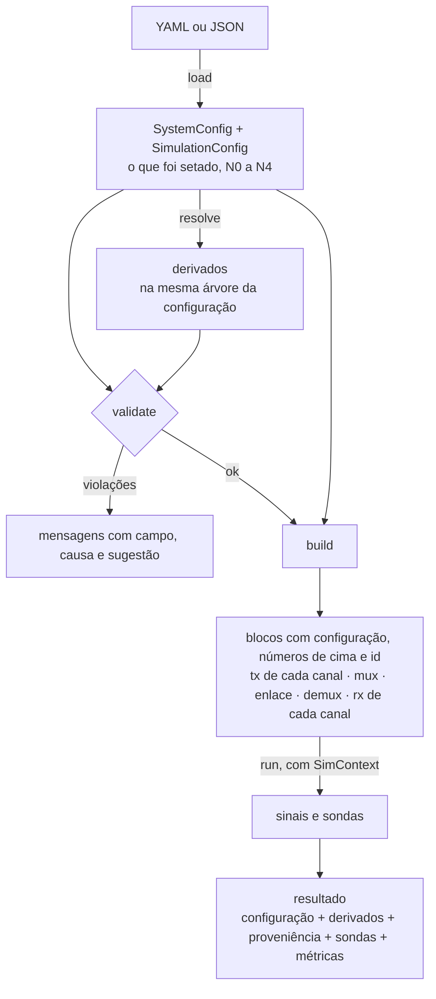

# Mapa do projeto e lacunas de arquitetura

Levantamento de 2026-11-09, para discussão do grupo antes de montar o sistema (TX, enlace e RX a
partir da configuração). Mesma convenção de marcas dos guias: **[Fato: fonte]**, **[Dedução]**,
**[Proposta]**, **[Dúvida]**. **[Medido]** marca números obtidos em 2026-11-09 e 2026-11-10 com o
ambiente do repositório (`repo/.venv`), lendo o pacote sem alterar nenhum arquivo.

Revisto em 2026-11-10 com os três comentários do Gabriel, que estão no Resumo com as respostas. As
seções que mudaram por causa deles: 3.3 (lado elétrico), 4.5 (molde do bloco), 5.7 (medida do efeito
de borda) e 5.12 (dados para plotagem).

Fontes: código em `src/simcopy` (branch `laser`, cópia de trabalho); `docs/proposta_bloco_fibra.md`;
`notebooks/07_sistema_imdd.ipynb` (versão de 2026-11-09); o documento de arquitetura
(`docs/03-class/arquitetura-simulador-optico (1).md`, citado como "arquitetura"); o RFC 0001
(`docs/01-class/`); as notas de aula; `docs/duvidas_abertas.md` (dúvidas citadas por número).

O documento irmão, `docs/proposta_api_interface.md`, parte deste mapa para propor como o projeto
vira API com interface.

---

## Resumo

1. **O pacote foi construído pelas duas pontas.** A configuração veio de cima (o cenário coerente do
   VPI) e os kernels vieram de baixo (Agrawal, um por componente da aula). A camada que liga as
   duas, blocos e montagem, tem 2 blocos (os lasers) dos 22 que o layout da arquitetura lista
   (seção 11.1), nenhuma função de montagem (`build_tx`, `build_link`, `build_rx`) e nenhum
   executor.
2. **O notebook 07 é o primeiro uso de ponta a ponta e fez à mão o papel dessa camada**: gerar
   bits, filtrar, embalar em `Waveform`, converter configuração em parâmetros de kernel, escolher
   sementes, calcular bandas e repetir a análise. Cada linha da seção 3 aponta a peça que falta.
   (Comentário - a parte de geração d ebits e filtragem do sinal elétrico ainda não foi feita, e precisa ser)

   (Resposta - de acordo. A seção 3.3 lista as peças do lado elétrico, as escolhas que o notebook 07
   já fez e as duas decisões que faltam para implementar: dúvidas 49 e 50.)

   (Comentário - outra coisa que ainda não foi feita mas está prevista é a geração de dados para plotagem. Por exemplo, no notebook, geralmente se interessa o que está na entrada/saída de componentes, mas nem sempre essa entrada/saída é a melhor representação. Por exemplo, no caso da fibra, sua entrada/saída é um sinal ópitco, e a sua potência e chirp precisam ser calculadas, não extraídas do componente. Se cada componente fornecesse um fácil mecanismo de plotagem, uma simples função que plotasse as informações de entrada/saída de interesse, no domínio do tempo e da frequência, isso seria bem útil)

   (Resposta - entrou como lacuna própria, seção 5.12. Proponho uma função só,
   `plot_io(entrada, saída)`, fora dos blocos, porque a regra do projeto é que blocos não plotam.
   Ela escolhe os painéis de tempo e de frequência pelo domínio de cada sinal, e por isso vale para
   todo componente sem código de plotagem em cada um. O que é interno ao componente e não está na
   entrada nem na saída, como N(t) e S(t) do laser, sai por um gravador. Testei um protótipo fora do
   repositório com laser, fibra e fotodetector. Dúvida A10.)

3. **"Fibra em kernel" estava previsto e não é o erro** (princípio PR-6 da arquitetura). O que não
   foi previsto está na seção 5. Os itens que travam a montagem: o contrato de bloco de uma entrada
   e uma saída, os dois caminhos de `resolve`, `f0` com dois significados, metadados do `Waveform`
   que só valem para um canal, sementes sem identidade de bloco e sinais não periódicos numa janela
   periódica.
4. **Proposta de aninhamento** (seção 4): tudo que é setado chega ao bloco pelo construtor, na
   montagem; os derivados saem de uma função única por dispositivo, a mesma para o validador e para
   o bloco; o contexto leva só o que é da execução (grade, semente, gravador de sondas).
   (Comentário - e se a fibra entrar como outros componentes que já montamos? )

   (Resposta - li como: fazer o bloco da fibra no mesmo molde dos lasers. Dá, e é a mudança menor;
   refiz a seção 4.5 assim. A versão anterior deste documento propunha um molde novo, com os
   derivados entregues prontos ao bloco e um `from_config` para o notebook; ele dava a mesma
   garantia com dois construtores e obrigaria a refazer os lasers. O que a fibra precisa de
   diferente da proposta de 05/11 é só a origem da frequência: construtor, como no laser, e não
   `x.f0`.)

---

## 1. Mapa do repositório

### 1.1 O pacote por camada

| Camada | Arquivos | Conteúdo | Estado |
|---|---|---|---|
| `core` | `units`, `grid`, `signals`, `context` | constantes e conversões; `TimeGrid`; `Bits`, `Symbols`, `Waveform`, `DigitalSignal`, `SignalGeometry`; `SimContext.rng_for` | em uso; nenhum bloco produz `Bits`, `Symbols` ou `DigitalSignal` ainda |
| `config` | `system`, `simulation`, `resolve`, `io` | árvore do cenário (canal IMDD ou coerente, enlace, trechos); derivados; leitura de YAML | completa para o cenário coerente do VPI; IMDD incompleto (dúvidas 5, 50, 51, 52) |
| `validation` | `base`, `rules` | 7 regras sobre o sistema inteiro | em uso pelo `cli` |
| `kernels` | `ssfm`, `birefringence`, `laser/*`, `modulator/mzm`, `amplifier`, `photodetector`, `wdm` | física em funções puras, com números e arrays | um por componente da aula, conferido contra forma fechada nos notebooks 01 a 06 |
| `components` | `tx/laser.py` | `CWLaser`, `DirectModulatedLaser` | 2 blocos; `optical/` e `rx/` vazios; sem `base.py` (`Block`, `Probe`) |
| `pipelines` | nenhum | nenhum | vazio |
| `cli` | `validate`, `resolve` | imprime derivados e violações de um YAML | em uso |
| `testing` | `approx`, `fisica` | apoio aos testes | 73 testes coletados (núcleo, configuração, validação, fibra) **[Medido]** |

**[Fato: arquitetura, seção 11.1]** Faltam por inteiro, em relação ao layout previsto:
`core/constellation`, `core/frame`, `kernels/filters`, `kernels/dsp`, `components/base`,
`pipelines/*`, `metrics/*`, `plotting/*`.

### 1.2 Componente por componente

| Componente | Configuração | Derivados | Kernel | Bloco | Notebook |
|---|---|---|---|---|---|
| Sequência de bits | `seed` do canal (sem uso) | `n_bits` na geometria | não | não | 07, à mão |
| Sinal elétrico (NRZ, Bessel ou Nyquist) | `rolloff` | não | não | não | 07, à mão |
| Laser CW | `CWLaserConfig` | não | `laser/cw` | `CWLaser` | 02 |
| Laser de modulação direta | `RateEquationLaserConfig`, fora do canal IMDD | `resolve_rate_equation_laser`, fora do `resolve` do sistema | `laser/rate_equations`, `small_signal` | `DirectModulatedLaser` | 02, 07 |
| MZM e IQ | `MZMConfig`, `IQImpairments` | não | `modulator/mzm` (usa 2 dos 6 campos do `MZMConfig`) | não | 03 |
| Fibra | `FiberConfig`, `BirefringenceConfig` | `resolve_fiber` (sem PMD) | `ssfm`, `birefringence` | não (proposta) | 01, 07 |
| EDFA | `AmplifierConfig` | não | `amplifier` | não | 04 |
| Mux e demux | `channel_spacing`, `optical_bandwidth` | `channel_offsets` | `wdm` | não | 06 |
| Fotodetector | `PhotodiodeConfig` | não | `photodetector` | não | 05, 07 |
| Decisão, BER, fator Q | não | não | não | não | 05 (conta no notebook) |
| Oscilador local, híbrida, detecção balanceada | `CoherentReceiver` | não | não | não | não |
| ADC e DSP | `ADCConfig` | regra de divisão do SpS | não | não | não |

A tabela mostra o desenho do problema: as colunas das pontas (configuração e kernel) estão cheias, a
do meio (bloco) tem duas entradas.

### 1.3 Documentos e notebooks

- Guias por componente: `docs/laser.md`, `moduladores.md`, `amplificadores.md`, `fotodetectores.md`,
  `mux_demux.md`. Cada um tem os fatos, a proposta de bloco e as dúvidas.
- `docs/duvidas_abertas.md`: 55 perguntas, 17 com resposta, 38 em aberto.
- `docs/planejamento.md`: 5 semanas a partir de 26/10. A semana 1 previa os blocos de sequência,
  NRZ com Bessel, fibra, fotodetector e sonda. Em 09/11 (início da semana 3) existem as propostas e
  o notebook 07 escrito sobre os kernels; os blocos não existem.
- `docs/proposta_bloco_fibra.md`: seção 2 deste documento.
- Notebooks 01 a 06: par `.py` (jupytext) e `.ipynb` executado. Notebook 07: só `.ipynb`.

### 1.4 Infraestrutura

- `pyproject.toml`: dependências `numpy`, `scipy`, `pyyaml`; contrato de camadas do `import-linter`:
  `core < config < validation < kernels < components < pipelines`.
- CI: testes (Python 3.11 a 3.13), lint, CodeQL e publicação no PyPI. `lint.yml` e `publish.yml`
  usam Python 3.10, abaixo do `requires-python >= 3.11`. `import-linter` e `mypy` não rodam no CI.
- `README.md` descreve o estado anterior aos componentes ("não há transmissor, receptor nem BER") e
  não cita lasers, moduladores, amplificador, fotodetector nem mux.
- Na raiz, versionados: `draft.py`, `draft_fixed.py`, `plot_results.py` (legado).
- `src/simcopy/core/tests/test_birefringence.py` (não rastreado) quebra a coleta do pytest
  (dúvida 45).

### 1.5 Fora do repositório (só na máquina do Gabriel)

- `pacote/simcopy/`: cópia de setembro do pacote, com documentos que não estão no repositório
  (`CLAUDE.md`, `docs/decisoes.md`, `roadmap.md`, `historico.md`, `reference/vpi/`), pendente da
  tarefa 0 (dúvida 38). O `src/` dessa cópia é antigo: ainda tem `LaserConfig` e não tem
  `kernels/modulator`.
- `pacote/*.ipynb`: notebooks do professor (3 a 6).
- Dois ambientes: `repo/.venv` (o que os notebooks usam, com o `simcopy` instalado em modo editável)
  e `.venv` na pasta de cima (sem o `simcopy` instalado).

---

## 2. A proposta do bloco de fibra

### 2.1 O que ela diz

**[Fato: `docs/proposta_bloco_fibra.md`]**

- O kernel (`propagate`) e a configuração (`FiberConfig`, `resolve_fiber`) existem; o bloco não.
  Quem liga o laser à fibra monta `FiberKernelParams` à mão, e a PMD, que está na configuração e
  não passa pelo `resolve_fiber`, é esquecida sem aviso.
- Propõe `Fiber(fiber, index, max_step)` em `components/optical/fiber.py`, no molde do laser, com
  uma função `fiber_kernel_params(cfg, resolvido)` que faz o mapeamento num lugar só.
- Lista 8 pontos a decidir: origem da frequência central, sorteio de rotações com PMD zero, PMD
  ligada por padrão, passo máximo, atraso de grupo, janela periódica, evolução ao longo de z, e
  SMF + DCF + EDFA.
- Seção 7 (nota de 09/11): o MZM está na mesma situação. Só existe o kernel, que trabalha com
  arrays e usa 2 dos 6 campos do `MZMConfig`.

### 2.2 Onde ela encosta em problemas do sistema inteiro

A proposta resolve a fibra. Cinco dos seus pontos e a nota sobre o MZM são casos particulares de
lacunas que valem para todos os blocos:

| Ponto da proposta | Lacuna geral | Aqui |
|---|---|---|
| 1. Frequência central lida de `x.f0` | `f0` tem dois significados no projeto | 5.4 |
| 2. Chave `("fiber", index, "pmd")` | chaves de semente escolhidas em cada ponto de uso | 5.6 |
| 4. `ctx` não leva o passo máximo do SSFM | parâmetros numéricos da simulação não têm caminho até os blocos | 4.2, 5.9 |
| 6. Janela periódica | fontes e filtros não geram sinais periódicos | 5.7 |
| 8. SMF + DCF + EDFA é composição | o cenário descreve uma topologia só | 5.8 |
| Seção 7. O MZM recebe portadora e sinal | bloco de uma entrada e uma saída | 5.2 |

### 2.3 Ajuste sugerido antes de implementar

**[Dedução]** O ponto 1 da proposta e a dúvida 2 puxam para lados opostos. A proposta lê a
frequência absoluta de `x.f0` e recusa `f0 <= 0`. A arquitetura define `f0` como o desvio em relação
ao centro da banda (seção 4.2), o `resolve` do sistema o calcula assim (0 Hz para um canal só)
**[Medido]**, e a dúvida 2 registra que os lasers serão corrigidos para o desvio. Feita essa
correção, o canal central chega à fibra com `f0 = 0`, canais abaixo do centro chegam com `f0 < 0`, e
o campo agregado do WDM não tem frequência de canal. O `resolve` do sistema já calcula β₂ e γ na
frequência central (`resolve.py:116`).

**[Proposta]** A fibra recebe a frequência no construtor, como o laser (`CWLaser(laser, frequency)`),
e não do sinal. A seção 4.5 tem o esboço.

---

## 3. Desafios do notebook 07

O notebook cobre as etapas E1 a E4 da aula e começa a E5. A tabela lista o que foi feito à mão, a
lacuna do pacote que obrigou a isso e o efeito.

| Trecho | Feito à mão | Lacuna no pacote | Efeito |
|---|---|---|---|
| Bits | `np.random.randint` (gerador global) | não há fonte de bits; a `seed` do canal não é usada por nenhum código | a sequência muda a cada execução; fora da regra de aleatoriedade só por `ctx.rng_for` |
| Filtro de Bessel | `scipy.signal.bessel(3, 0.1)` digital com `lfilter` | não há filtro elétrico de transmissor; o Bessel de `kernels/photodetector` é outro (analógico, aplicado na FFT) | −3 dB em 7,15 GHz e não em 10 GHz; atraso de 38,9 ps; transiente de cerca de 56 amostras no início **[Medido]** |
| Espectro do sinal elétrico | `fs = 10000` provisório | o sinal nasce sem grade; a taxa real só aparece na célula seguinte | eixo de frequência fora de escala |
| Embalagem | `TimeGrid`, `SignalGeometry`, `Waveform` e `SimContext` montados à mão | não há construtor para uma cadeia parcial; o `resolve` exige o sistema completo | 100 símbolos × 20 amostras = 2000; pelo `resolve`, a mesma escolha daria N = 2048, 102 símbolos e 8 amostras sem símbolo **[Medido]** |
| Laser | 13 parâmetros no notebook; `gain_compression = 1e-7 * volume` convertido à mão; `bias_ratio` e `modulation_ratio` | `DirectModulation.laser` é `CWLaserConfig` (dúvida 5); as razões de corrente não têm lugar na configuração | o laser direto não pode vir de um arquivo de cenário |
| Análise (potência, chirp, espectro) | o mesmo código 4 vezes; sinal de menos do chirp e `optical_frequency` lembrados à mão | não há módulo de análise nem sonda | um eixo sem `fftshift` já produziu um gráfico errado nesta célula |
| Fibra | `resolve_fiber`, `FiberKernelParams`, `propagate` e `with_samples`, 3 vezes | não há bloco (seção 2) | a PMD da configuração não chega ao kernel; o passo máximo fica no padrão do kernel |
| Varredura de distância | laço com a cadeia refeita a cada ponto | não há executor nem varredura | ver 5.11 |
| Fotodetector | banda `bandwidth_factor * Rb` calculada à mão; 4 funções do kernel; chave `"rx_noise"` escolhida no notebook | não há bloco; o `resolve` não calcula a banda do receptor; as chaves de ruído não têm registro | o guia do fotodetector propõe `"rx_photodiode"` para o mesmo papel; toda chamada de `detect` repete a mesma realização de ruído (5.6) |
| Critério de desempenho | anotação: "20–40 km passo 1, estimar BER por fator Q" | não há `metrics/` (Q, BER, olho) nem instante de amostragem | os filtros somam 38,9 ps (acionamento) + 29,3 ps (fotodetector) = 68 ps de atraso num bit de 100 ps **[Medido]** |
| MZM (em andamento) | import de `pacote.simcopy.src...`; `iq_field(campo, sinal, mzm_config)` | não há bloco de modulador; o kernel recebe tensões e números, não configuração | ver 3.1 |

### 3.1 A célula do MZM

**[Fato: notebook 07, última célula; Medido para os imports]**

- `from pacote.simcopy.src.simcopy.config.system import MZMConfig`: se o Python do notebook estiver
  rodando com a pasta de cima (a que contém `pacote/`) como diretório de trabalho, esse import
  funciona e entrega a classe da cópia antiga do pacote, que é outra classe, de um módulo que ainda
  tem `LaserConfig`; em qualquer outra pasta ele falha. Nos dois casos a linha seguinte
  (`...kernels.modulator.mzm`) falha, porque a cópia antiga não tem esse módulo. Os caminhos do
  pacote instalado são `simcopy.config.system` e `simcopy.kernels.modulator.mzm`.
- `iq_field = iq_field(optical_field, electrical_waveform.samples[0], mzm_config)`: a assinatura do
  kernel é `iq_field(field, v_i, v_q, vpi, v_bias, quadrature_phase, ...)`, com tensões e números. O
  nome da função é sobrescrito pelo resultado. `iq_field` é o modulador em quadratura (coerente);
  para IMDD com modulação externa o par é `push_pull` e `mzm_field`. A seção 7 de
  `docs/proposta_bloco_fibra.md` tem o uso manual já verificado.
- A entrada do MZM é a saída do laser de modulação direta. A etapa E5 da aula pede laser de onda
  contínua.
- A fibra propaga `optical_waveform.samples`, a saída do laser. O resultado do MZM não entra na
  cadeia.
- `photodiode_bandwidth` vem de outra célula, e a cadeia inteira foi copiada da célula anterior.
- A célula está sem contagem de execução; a figura gravada pode ser de uma versão anterior do
  código.

### 3.2 O que os desafios têm em comum

- O notebook usa a API dos kernels (arrays e números) porque é a única que cobre a cadeia. A
  arquitetura previa `kernels/` como interno (seção 11.4).
- Cada passagem de um kernel ao seguinte exige um adaptador (configuração para números, array para
  `Waveform`, semente, banda), e hoje esse adaptador não mora em lugar nenhum.
- A cascata de configuração não é usada: `resolve` e `validate` exigem o sistema completo, e a
  aula monta cadeias parciais.

### 3.3 O lado elétrico: o que falta para sair do notebook

**[Fato: notebook 07, primeira célula]** A geração de bits e o filtro vivem em três funções do
notebook (`generate_binary_data`, `upsampling`, `bessel_filter`), com a anotação "nada disso foi
configurado no simcopy ainda". Na cadeia IMDD, só esta ponta e a outra (decisão e fator Q, 5.7)
ainda não têm kernel.

| Peça | No notebook 07 | No pacote (proposta) | Decisão que falta |
|---|---|---|---|
| Fonte de bits | `np.random.randint(0, 2, n_bits)` | função com `rng` e bloco de fonte; saída do tipo `Bits`, que já existe em `core/signals` | sequência aleatória pela semente, como no notebook, ou PRBS (dúvida 49); papel da `seed` do canal (A5) |
| Mapeamento | nenhum (OOK) | identidade para OOK; tabela para PAM4 depois | formato do IMDD (dúvida 51) |
| Formatação NRZ | `np.repeat(bits, sps)` | `Waveform` elétrico (1, N), com a grade do contexto e a geometria do canal | nenhuma |
| Filtro de Bessel | ordem 3, `wn = 0.1`, `lfilter` | uma função de resposta só, em `kernels/filters.py`, aplicada na FFT; a mesma para o acionamento, o S21 do modulador e o fotodetector | ordem e banda (dúvida 50) |

**[Medido]** O `wn = 0.1` do notebook corresponde a 10 GHz na grade de 200 GHz, uma vez a taxa de
bits. O filtro digital do SciPy, com a normalização padrão, fica com −3 dB em 7,15 GHz. A função do
pacote (`lowpass_response`: protótipo analógico, −3 dB na banda pedida) com 10 GHz e ordem 3 dá
−3 dB em 10,0 GHz, atraso de 27,9 ps e banda de ruído de 10,7 GHz. As duas definições entregam ao
laser sinais diferentes com o mesmo número escrito.

**[Dúvida]** Para implementar faltam duas confirmações. São as dúvidas 49 e 50, agora com o
notebook como ponto de partida:

1. Bits aleatórios pela semente, como no notebook, e não PRBS?
2. Bessel de ordem 3 com −3 dB em uma vez a taxa de bits (10 GHz a 10 Gb/s), na definição do
   pacote?

---

## 4. Como aninhar tudo na montagem do sistema

### 4.1 O que a cascata já define

**[Fato: arquitetura, seção 4.5.1; `config/`]** Cinco níveis; cada nível só pode ser decidido depois
do anterior.

| Nível | Setado (dono) | Derivado | Quem consome hoje |
|---|---|---|---|
| N0 Simulação | `sampling_rate`, `simulation_window`, `root_seed`, passo e fase máxima do SSFM | N, dt, janela | `resolve`, validador; nenhum bloco recebe o passo do SSFM |
| N1 Sistema | `center_frequency`, `channel_spacing` | desvio de cada canal | `resolve`; os lasers recebem a frequência absoluta à mão |
| N2 Canal | `kind`, `symbol_rate`, `modulation`, `pol`, `seed`, `launch_power` | SpS, número de símbolos, geometria | `resolve`, validador |
| N3 Dispositivos do canal | laser, MZM, fotodetector, ADC | limiar e eficiência do laser (fora do `resolve` do sistema) | só os lasers |
| N4 Enlace | trechos: fibra, amplificador, compensação | β₂, γ, α, L_eff | `resolve`, validador |

### 4.2 Regras propostas

**[Proposta]**

1. Cada valor setado tem um dono, num nível da cascata. Já é assim em `config/`.
2. Cada valor derivado sai de uma função única por dispositivo (`resolve_fiber`,
   `resolve_rate_equation_laser`). O `resolve` do sistema reúne todos na árvore de derivados, no
   mesmo caminho da configuração de onde saíram.
3. Um bloco recebe no construtor a configuração do seu dispositivo e, como número, o que vem de
   cima (frequência central, passo máximo). Calcula os próprios derivados com a função do item 2,
   uma vez. Não lê o sistema e não olha outros blocos.
4. O que depende do conjunto (solver vetorial, potência total, banda ocupada, número de canais que o
   amplificador vê) é derivado no `resolve` e chega ao bloco como número.
5. O `SimContext` leva só o que é da execução: grade, semente raiz e o gravador de sondas. Os
   parâmetros numéricos de N0 (passo do SSFM, subpasso do laser) são ligados aos blocos na montagem.
6. Cada bloco tem um `id` dado pela montagem (`ch0.tx.laser`, `link.span2.amp`). O `id` é a chave do
   `rng_for`, o rótulo da sonda e o endereço nas mensagens de erro. O `CWLaser` já tem um campo com
   essa função para a semente (`rng_role`).

**[Fato: RFC 0001, seção 31]** O RFC punha o sistema inteiro dentro do contexto, para o bloco
consultar. A arquitetura tirou (contexto com grade e semente). **[Proposta]** Manter fora: um bloco
que lê o sistema pelo contexto volta a depender de estado que não está na sua assinatura, que é o
que o princípio PR-1 proíbe.

### 4.3 Fluxo



É o fluxo da seção 6.3 da arquitetura, com duas precisões: o `resolve` cobre também os
dispositivos, e cada bloco calcula os próprios derivados com as mesmas funções que o `resolve` usa
(4.5). O validador e o bloco veem o mesmo número porque chamam a mesma função com as mesmas
entradas.

### 4.4 As variáveis do notebook 07 na cascata

| No notebook 07 | Dono na cascata | Chega ao bloco por | Hoje |
|---|---|---|---|
| `Rb = 10e9` | `IMDDChannel.symbol_rate` (N2) | construtor dos blocos do canal | existe |
| `sps`, `n_bits`, `fs = Rb * sps` | `SimulationConfig.from_symbols` (N0) | `ctx.grid` e geometria do canal | existe; o `resolve` exige o sistema completo |
| `TimeGrid(...)`, `SignalGeometry(...)` | derivados do `resolve` | `ctx.grid`, fonte de bits, formatador | existe |
| `SimContext(grid, root_seed=1)` | `SimulationConfig.root_seed` (N0) | executor | sem construtor a partir do `resolve` |
| bits | semente do canal (N2) | fonte de bits | sem bloco; papel de `seed` e de `root_seed` indefinido (5.6) |
| Bessel `(3, 0.1)` | transmissor IMDD (N3) | formatador | sem campo (dúvida 50) |
| 13 parâmetros do laser, razões de corrente | `DirectModulation` (N3) | `DirectModulatedLaser` | a configuração não comporta (dúvida 5) |
| `f0 = c / 1550 nm` | `center_frequency` (N1) mais o desvio do canal | construtores do laser, da fibra e do amplificador | os blocos põem a frequência absoluta no `f0` do sinal (5.4) |
| `FiberConfig(length=...)` | `LinkConfig.spans[i].fiber` (N4) | `Fiber` | existe; um trecho é uma fibra só (dúvida 52) |
| β₂, γ, α | derivados da fibra | `Fiber` | existe; a PMD fica de fora |
| passo do SSFM | `SimulationConfig.ssfm_max_step` (N0) | `Fiber(max_step=...)` | nenhum bloco recebe |
| banda do fotodetector | `bandwidth_factor` × `symbol_rate` | `Photodiode` | não é derivada no `resolve` |
| ruído ligado ou desligado | dispositivo ou simulação | fotodetector, laser, amplificador | dois donos (dúvida 6) |

### 4.5 O molde de um bloco, com a fibra de exemplo

**[Proposta, refeita em 2026-11-10 depois do comentário do Gabriel no Resumo]** A fibra entra como
os lasers: configuração e frequência no construtor, e o bloco calcula os próprios derivados. É a
proposta de `docs/proposta_bloco_fibra.md` com duas mudanças: a frequência vem do construtor, como
em `CWLaser(laser, frequency)`, e não de `x.f0` (2.3); e a chave da semente é o `id`, no lugar de
`("fiber", index)`. Esboço, não código final:

```python
@dataclass(frozen=True)
class Fiber:
    fiber: FiberConfig
    frequency: float                   # frequencia central da banda [Hz]
    id: str = "fiber"                  # chave da semente e rotulo da sonda
    max_step: float = 5e3              # passo maximo do SSFM [m]

    @cached_property
    def params(self) -> FiberKernelParams:
        """Numeros que o kernel recebe: a mesma conta que o resolve do sistema faz."""
        return fiber_kernel_params(self.fiber, resolve_fiber(self.fiber, self.frequency))

    def __call__(self, x: Waveform, ctx: SimContext) -> Waveform:
        x.require(Domain.OPTICAL, self.id)
        pmd = x.n_pol == 2 and self.params.pmd_coefficient > 0
        rng = ctx.rng_for(self.id, "pmd") if pmd else None
        return x.with_samples(propagate(x.samples, x.grid.omega, self.params, rng, self.max_step))
```

No notebook, uma linha no lugar das seis de hoje:
`Fiber(FiberConfig(length=20e3), f0)(optical_waveform, ctx)`.

Na montagem do sistema:
`Fiber(span.fiber, system.center_frequency, id=f"link.span{i}.fiber", max_step=simulation.ssfm_max_step)`.

**[Medido, 2026-11-09, com o esboço fora do repositório]** −4,0000 dB em 20 km; β₂ e γ do bloco
iguais aos do `resolve` do sistema quando a montagem passa `system.center_frequency`; mesma semente,
mesma saída; `id` diferente, outra realização de PMD; entrada elétrica recusada.

O que garante o caminho único de `resolve` (5.3) não é o molde, é a função: o bloco e o `resolve` do
sistema chamam `resolve_fiber` com a mesma frequência. `fiber_kernel_params` continua sendo o único
lugar em que a PMD pode ser esquecida. `cached_property` numa dataclass congelada já é usado no
pacote (`TimeGrid`), e evita refazer a conta a cada chamada; no laser, hoje, ela é feita duas vezes
por chamada.

A alternativa que este documento propunha antes (o bloco receber `FiberKernelParams` prontos, com
um `from_config` para o notebook) dá a mesma garantia com dois construtores e obrigaria a refazer os
lasers. Não vejo ganho que pague isso.

### 4.6 Cadeias da aula e sistema completo

**[Proposta]** Os mesmos blocos servem aos dois usos.

- **Sistema completo**: `load`, `resolve`, `validate`, `build`, `run`. As condicionais (IMDD ou
  coerente, direta ou externa, com ou sem compensação) são escolhas da montagem, como a arquitetura
  já define (seção 6.2).
- **Cadeia parcial (aula, E1 a E13)**: os blocos encadeados à mão no notebook, cada um criado
  direto com a configuração do seu dispositivo, e um contexto criado a partir de
  `SimulationConfig`. Sem `SystemConfig`.

---

## 5. O que não foi previsto

| # | Lacuna | Trava |
|---|---|---|
| 5.1 | A camada do meio ficou para o fim | montagem IMDD |
| 5.2 | Bloco de uma entrada e uma saída | modulação externa, WDM, coerente |
| 5.3 | Dois caminhos de `resolve`; ordem das camadas | montagem IMDD |
| 5.4 | `f0` com dois significados | bloco de fibra, WDM |
| 5.5 | Metadados do `Waveform` | WDM, modulador |
| 5.6 | Sementes sem identidade de bloco | vários trechos, varreduras |
| 5.7 | Janela periódica, quadro e atrasos | BER e fator Q |
| 5.8 | O cenário descreve uma topologia só | cadeias da aula |
| 5.9 | Configuração em dois lugares, campos sem consumidor | montagem por arquivo, interface |
| 5.10 | Validação pela banda do roll-off | IMDD com laser direto |
| 5.11 | Custo de execução | varreduras |
| 5.12 | Dados para plotagem sem dono | notebooks de sistema, interface |

Em cada item, "Previsto" cita o que a arquitetura dizia; os números de seção dessa linha são da
arquitetura.

### 5.1 A camada do meio ficou para o fim (e a "fibra em kernel")

- **Previsto.** PR-6: "`Fiber` é um objeto de configuração fina; `ssfm_manakov(...)` é uma função
  pura em `kernels/`". Ordem das fases: núcleo, kernels, componentes (seção 12). `kernels/` interno
  na v1 (seção 11.4).
- **O que aconteceu.** A aula pediu um notebook por componente. Fizemos o kernel de cada um e
  paramos antes do bloco: os guias registram "blocos não feitos", à espera das dúvidas. No notebook
  07 a API de uso virou a dos kernels.
- **Consequência.** Por componente existem até três objetos (configuração, derivados, parâmetros do
  kernel) e ninguém é dono do mapeamento entre eles. Na fibra: `FiberConfig` (5 campos e 3 de
  birrefringência), `ResolvedFiber` (5) e `FiberKernelParams` (7). O mapeamento feito à mão já
  perdeu a PMD (notebook 07). No MZM, 4 dos 6 campos da configuração ainda não chegam ao kernel:
  perda de inserção e extinção têm o mapeamento decidido (`docs/moduladores.md`, seção 8) e não
  implementado, e o filtro S21 não tem kernel.
- **Leitura.** Fibra em kernel não é o erro. A separação é o que permitiu conferir cada efeito
  contra forma fechada (notebooks 01 a 06, testes de física) sem montar sistema. O que faltou foi
  construir o bloco fino junto com o kernel.
- **[Proposta]** Antes de qualquer capacidade nova, um bloco para cada kernel existente, com uma
  função de mapeamento por componente (como `rate_equation_params` no laser). Critério de pronto: o
  notebook 07 reescrito sem importar `simcopy.kernels`.

### 5.2 Bloco de uma entrada e uma saída

- **Previsto.** `Block.__call__(x, ctx) -> Signal` e composição por lista (seção 5.3 e anexo A.1). O
  motor de fluxo de dados foi rejeitado (seção 5.2). O RFC 0001 (seções 19 e 38) propunha entradas
  e saídas declaradas e o pipeline como grafo tipado; isso não entrou.
- **O que aconteceu.** Poucos componentes da aula têm uma entrada e uma saída. Fontes (bits, laser
  CW, oscilador local) não têm entrada. MZM e IQ recebem portadora e sinal elétrico. Mux é N para
  1; demux é 1 para N. O receptor coerente recebe sinal e oscilador local; a detecção balanceada,
  duas entradas. As etapas E12 e E13 da aula acrescentam um segundo laser e um segundo fotodetector
  no receptor (leitura do `docs/planejamento.md`, dúvida 55). No código: o `CWLaser` recebe um sinal
  elétrico só para ler a grade e o canal (`laser.py:48`), e a proposta do modulador externo põe o
  laser dentro do bloco (`docs/moduladores.md`, seção 6).
- **Consequência.** Blocos compostos escondem sinais que a aula pede para monitorar (a saída do
  laser dentro do modulador). Um laser compartilhado (oscilador local derivado do laser do
  transmissor, dúvida 54) não cabe numa lista. Um editor de esquemático precisaria conhecer as
  portas de cada bloco.
- **[Proposta]** Manter listas e blocos compostos para o sistema: transmissor e receptor compostos,
  mux e demux resolvidos pelo executor (como no fluxo 6.3 da arquitetura). Acrescentar: (a) portas
  declaradas como dado em cada bloco (domínio de cada entrada e da saída), sem motor; (b) fontes sem
  entrada; (c) um gravador de sondas no contexto, para os sinais internos de um bloco composto, já
  que o `Probe` que embrulha o bloco só enxerga a saída. O grafo geral fica para quando houver
  editor (ver `docs/proposta_api_interface.md`).

### 5.3 Dois caminhos de `resolve` e a ordem das camadas

- **Previsto.** Carregar, resolver, validar, construir (seção 6.3). Derivados calculados no
  `resolve` e nunca aceitos como entrada (seção 4.5.2).
- **O que aconteceu.** `resolve(system, simulation)` cobre grade, canais e fibras e alimenta o
  validador e o `cli`. Os blocos resolvem por conta própria durante a execução: o laser chama
  `resolve_rate_equation_laser` duas vezes por chamada (`laser.py:85` e `laser.py:90`), e a proposta
  da fibra chama `resolve_fiber(cfg, x.f0)`. Laser, fotodetector e amplificador não aparecem nos
  derivados do sistema.
- **Consequência.** O validador não vê o que o bloco vai usar (limiar do laser, subpassos por
  amostra, banda do receptor). Os dois caminhos podem dar respostas diferentes para a mesma fibra:
  β₂ na frequência central e na de um canal a +112,5 GHz diferem 0,12 % **[Medido]**.
- **Causa de fundo. [Dedução]** O contrato de camadas pôs `config` e `validation` abaixo de
  `kernels`. O `resolve` não pode usar fórmulas que moram em kernels (estado estacionário do laser,
  banda de pequeno sinal, banda de ruído do filtro). A física derivada se espalha por
  `core/units.py`, `config/resolve.py` e `kernels/`, e o mapeamento para os parâmetros do kernel só
  pode morar em `components/`. **[Fato: imports]** Hoje os kernels só importam `core`. O diagrama da
  arquitetura (seção 4.1) desenha configuração e kernels como ramos independentes; a ordem linear
  foi uma escolha do contrato.
- **[Proposta]** Um caminho só, pela função: cada dispositivo tem uma função de `resolve`, chamada
  pelo `resolve` do sistema e pelo bloco com as mesmas entradas (4.5). O `resolve` do sistema passa
  a cobrir laser, fotodetector e amplificador, para o validador enxergá-los. Opção a decidir
  (dúvida A1): pôr `kernels` abaixo de `config` no contrato
  (`core < kernels < config < validation < components < pipelines`), o que deixa o `resolve` e o
  validador usarem as fórmulas dos kernels. Nenhum arquivo muda de lugar.

### 5.4 `f0` com dois significados

- **Previsto.** `f0` é o desvio em relação ao centro da banda (seção 4.2).
- **O que aconteceu.** `resolve`: desvio, 0 Hz para um canal **[Medido]**. Lasers: frequência
  absoluta, 193,4 THz **[Medido]** (`laser.py:44`). `kernels/wdm`: desvios. Proposta da fibra:
  absoluta. Notebook 07: variável local `f0` absoluta, usada no eixo de comprimento de onda.
- **Consequência.** O bloco de fibra não pode ser escrito sem decidir (dúvida 2, aberta desde
  22/10).
- **[Proposta]** `Waveform.f0` é o desvio. A frequência absoluta do centro fica só na configuração
  (`SystemConfig.center_frequency`) e chega pelo construtor aos blocos que precisam dela (laser,
  para hν; fibra; amplificador). Funções de análise recebem a frequência central como argumento.

### 5.5 Metadados do `Waveform`

- **Previsto.** `Waveform(samples, grid, domain, geometry, f0, channel_id)`, com `SignalGeometry`
  como vínculo entre bits, símbolos e amostras (seção 4.2.1).
- **O que aconteceu.** A saída do laser tem `samples.shape = (2, N)` e `geometry.n_pol = 1`, e uma
  grade de 2048 amostras aceita uma geometria de 2000 **[Medido]**: nada confere a geometria contra
  as amostras (`signals.py:80-87`). **[Dedução]** Depois do mux o campo tem N canais, com taxas
  possivelmente diferentes, e não tem uma geometria; a saída de um laser CW não tem símbolos.
  `Domain.ELECTRICAL` cobre três grandezas: nível adimensional (entrada do laser), tensão (braços do
  MZM, dúvida 11) e corrente (saída do fotodetector). No notebook 07 um eixo de corrente está
  rotulado em volts.
- **Consequência.** Metadado errado passa em silêncio, e cada bloco supõe a unidade da entrada.
- **[Proposta]** Geometria opcional no `Waveform` (ausente no campo agregado e em portadoras) e
  conferida quando presente; `n_pol` lido só das amostras; unidade explícita do sinal (adimensional,
  V, A, √W), conferida no `require`. Os comentários do Gabriel em `signals.py` (linhas 28, 69 e 75)
  já perguntam por isso.

### 5.6 Sementes sem identidade de bloco

- **Previsto.** `ctx.rng_for(canal, bloco, papel)`, com streams independentes por chave (seção 8), e
  a semente como propriedade do canal.
- **O que aconteceu.** `rng_for` não guarda estado (`context.py:19-22`): a mesma chave devolve
  sempre a mesma sequência **[Medido]**. As chaves são textos escolhidos em cada ponto de uso:
  `"tx_laser_phase"` e `"tx_laser_noise"` (laser), `"rx_noise"` (notebook 07), `"rx_photodiode"`
  (guia do fotodetector), `("fiber", i, "pmd")` (proposta da fibra), `(trecho, "edfa_ase")`
  (arquitetura). **[Fato: busca em `src`]** `IMDDChannel.seed` e `CoherentChannel.seed` são lidos do
  YAML e não são usados por nenhum código; a relação com `root_seed` não está definida.
- **Consequência.** Dois blocos com a mesma chave geram o mesmo ruído. Dois amplificadores com a
  mesma chave somam a ASE em campo: a potência fica 4,00 vezes a de um, e não 2 **[Medido]**. Numa
  varredura todos os pontos usam a mesma realização, o que serve para comparar pontos e não serve
  para média de Monte Carlo. Um erro de digitação na chave não é detectado.
- **[Proposta]** A chave é o `id` do bloco, único por construção, mais o papel. O índice da
  realização entra como chave explícita nas varreduras de Monte Carlo. Falta decidir o papel de
  `channel.seed` (dúvida A5).

### 5.7 Janela periódica, quadro e atrasos

- **Previsto.** `FrameLayout` compartilhado entre TX e RX, com zeros de guarda no início e no fim e
  sequência de sincronismo (seção 8). Número de símbolos truncado: `floor(janela · Rs)` (seção
  4.5.2).
- **O que aconteceu.** Os kernels que usam FFT (fibra, filtros ópticos, filtro do fotodetector)
  tratam a janela como periódica. As fontes não geram sinais periódicos: o `lfilter` parte de estado
  nulo (transiente de cerca de 56 amostras) **[Medido]**; a fase do laser é um passeio aleatório,
  com fim diferente do início; o laser direto parte do estacionário de I(0); o truncamento do
  `resolve` deixa amostras sem símbolo (8 de 2048 no caso do notebook) **[Medido]**. O `FrameLayout`
  não foi implementado. Cada filtro soma atraso de grupo (68 ps no notebook 07) e ninguém o
  contabiliza; `TimeGrid.t0` existe e não é atualizado.
- **Consequência.** Há uma descontinuidade na borda da janela. Ela vira vazamento espectral (a
  janela de Hann do notebook 07 trata o sintoma) e, com dispersão, um transiente que entra na
  janela pelas duas bordas. A decisão e o fator Q dependem de um instante de amostragem que hoje
  nenhum código calcula.
- **[Medido, 2026-11-10]** Nas condições do notebook 07 (100 bits a 10 Gb/s, grade de 200 GHz,
  laser direto com ruído), comparei a saída da fibra com a do mesmo campo propagado numa janela 4
  vezes maior, em que as bordas ficam longe. As duas diferem mais de 5 % da potência média até esta
  distância de cada borda:

  | Fibra | 10 km | 20 km | 40 km | 80 km | 100 km |
  |---|---|---|---|---|---|
  | Bits contaminados em cada borda (média de 8 sequências) | 1,3 | 2,5 | 5,0 | 9,6 | 12 |

  No meio da janela a diferença fica abaixo de 1,2 %. O alcance segue π·|β₂|·L·fs, o atraso da
  componente que está na borda da banda de simulação: 1,28 ns em 100 km. Em 20 km são 250 ps; a
  estimativa do ponto 6 da proposta da fibra era de cerca de 130 ps. As causas são o degrau
  de amplitude (primeiro e último bits diferentes, transiente do `lfilter`) e o salto de fase do
  laser. O salto de fase sobra mesmo com o acionamento periódico: num teste com filtro aplicado na
  FFT e primeiro e último bits iguais, a fase salta 2,2 a 2,8 rad entre a última amostra e a
  primeira (entre vizinhas, 0,23 rad), e num trecho em que a saída do laser é plana a potência
  depois de 20 km ondula 24 %; com a fase fechada na janela, 5 %. É artefato numérico, não física.
  Com 100 bits e 100 km, cerca de um quarto da janela não serve para medir.
- **[Proposta]** Quadro com símbolos de guarda nas duas pontas, descartados no receptor (como o
  professor faz com `N_zeros_init` e `N_zeros_final`), e regra de validação com a guarda mínima de
  π·|β₂|·L·fs por borda. Opcional: fase da portadora fechada na janela, por uma rampa linear que
  zera o salto (equivale a deslocar a portadora em menos de 1/janela). Filtros elétricos aplicados
  na FFT, com a mesma função para transmissor e receptor (`kernels/filters.py`). Janela com número
  inteiro de símbolos de cada canal, ou a sobra na guarda. Sincronismo por correlação com a
  sequência conhecida, regenerada pela semente.

### 5.8 O cenário descreve uma topologia só

- **Previsto.** Canal com TX e RX; enlace com trechos de fibra e amplificador; trocar IMDD por
  coerente é mudança de configuração (critério C5).
- **O que aconteceu.** A aula monta cadeias parciais e variadas: só o laser (E2), laser e fibra
  (E3), fibra padrão e compensadora (E6), oscilador local com um fotodetector só (E12). Nenhuma cabe
  em `SystemConfig`, e `resolve` e `validate` exigem canal com TX e RX e enlace.
- **Consequência.** Os notebooks não usam a cascata. O que ela protege (derivados, validação) não
  protege as cadeias da aula.
- **[Proposta]** Dois níveis com os mesmos blocos (seção 4.6). No nível do sistema, o trecho vira
  uma lista de elementos (fibra, amplificador, filtro), para caber fibra padrão, compensadora e
  amplificador (dúvida 52).

### 5.9 Configuração em dois lugares e campos sem consumidor

- **Previsto.** Um dono por grandeza. A arquitetura recomendava pydantic v2 em `config/`, para as
  uniões discriminadas e o esquema (seção 4.6.1).
- **O que aconteceu.** `config/system.py` usa dataclasses e `config/io.py` monta os objetos à mão.
  Os padrões estão escritos nos dois arquivos (roll-off, desvio do oscilador local, banda óptica,
  PMD, comprimento de correlação, frequência central, espaçamento, figura de ruído). **[Medido]** O
  YAML aceita e descarta em silêncio `launch_power` do canal, `amplifier` do trecho, `sampling_rate`
  da simulação e uma chave com erro de digitação (`rollof`). Um canal IMDD dá `NameError` (dúvida
  43). **[Fato: busca em `src`]** `SimulationConfig.shot_noise`, `thermal_noise`,
  `ssfm_max_phase_change_deg` e a `seed` do canal não chegam a nenhum bloco. `ssfm_max_step` e
  `launch_power` só chegam a uma regra de validação; como o YAML não lê `launch_power`, a regra do
  passo não linear nunca dispara para um cenário carregado de arquivo.
- **Consequência.** O arquivo de cenário não é registro confiável do que foi simulado, e cada campo
  novo exige editar dois arquivos.
- **[Proposta]** Leitura e gravação geradas a partir das classes, com um dono só para o esquema e
  recusa de chave desconhecida com o caminho do campo (a issue #9 já registra os dois defeitos do
  `io.py`). Para uma interface, é o item que mais pesa: `docs/proposta_api_interface.md`, seção 5.

### 5.10 Validação pela banda do roll-off

- **Previsto.** `RequiresNyquistSatisfied` com banda `Rs · (1 + rolloff)` (seção 7.1).
- **O que aconteceu.** No IMDD com laser direto a banda vem do chirp: 99 % da potência em cerca de
  95 GHz, contra 27,5 GHz sem chirp, a 10 Gb/s (notebook 02, seção 9.1). O NRZ com Bessel não tem
  roll-off (dúvida 50).
- **Consequência.** A regra aprova uma grade em que o espectro do laser direto dobra.
- **[Proposta]** Cada transmissor declara, no `resolve`, uma estimativa da banda ocupada, e a regra
  usa essa estimativa. Depende de 5.3: a estimativa do laser usa fórmulas de `kernels/laser`.

### 5.11 Custo de execução

- **Previsto.** A FFT do SSFM como custo dominante (seção 15). Decisão D-10: sem GPU por enquanto.
- **O que aconteceu. [Medido, nesta máquina]** O integrador do laser direto é um laço em Python
  (`rate_equations.py:104-116`): 5,2 µs por subpasso e 0,52 s para 2000 amostras. Extrapolando
  para 10 GBd com 16 amostras por símbolo: 22 s para 4096 símbolos e 23 min para 262 144. A fibra
  custa 1,8 s por trecho de 80 km com (2, 2¹⁸) amostras e 7,2 s com (2, 2²⁰), em baixa potência
  (16 passos).
- **Consequência.** No IMDD com laser direto quem domina o tempo é o transmissor, não a fibra. Uma
  varredura de distância (20 a 40 km de 1 em 1, na anotação do notebook 07) refaz o laser em cada
  ponto se a cadeia for refeita inteira.
- **[Proposta]** O executor guarda a saída de cada estágio e só refaz o que depende do parâmetro
  varrido; o transmissor não depende do comprimento da fibra. Compilar o laço do laser (numba) se o
  tempo passar a limitar. Fator Q em vez de contagem de erros (arquitetura, seção 15.2, item 1), que
  é também o que a anotação do notebook 07 pede.

### 5.12 Dados para plotagem sem dono

- **Previsto.** Blocos não plotam (PR-5). Os dados que seriam plotados são gravados e exportados, e
  a plotagem é um consumidor separado (seção 2.2, F-5). O `Probe` embrulha um bloco e guarda a
  saída (seção 5.5), e o `plotting/` fica fora dos componentes (seção 11.1).
- **O que aconteceu.** Nada disso foi construído. No notebook 07, o que interessa em cada etapa não
  é o array de entrada ou de saída, é uma grandeza calculada a partir dele: potência e chirp no
  tempo, espectro na frequência. Essa conta está escrita 4 vezes, cada uma com o cuidado da
  convenção de frequência. Parte do que interessa nem está na entrada ou na saída: o
  `DirectModulatedLaser` calcula N(t) e S(t) e devolve só o campo (`laser.py:98` descarta N), e a
  fibra não devolve o campo ao longo de z (dúvida 32).
- **Consequência.** Cada notebook reescreve a análise, e um erro de eixo ou de sinal aparece como
  gráfico errado, não como erro. Uma interface não tem de onde tirar os dados.
- **[Proposta]** Três peças, nenhuma dentro dos blocos:
  1. `simcopy.analysis`: funções que recebem um `Waveform` e devolvem arrays com eixo e unidade
     (potência, chirp, espectro óptico, forma de onda, espectro elétrico, olho). A convenção de
     frequência fica escrita uma vez.
  2. `simcopy.plotting`, com matplotlib (o extra `figures` que o `pyproject.toml` já tem):
     `plot_io(entrada, saída)` monta os painéis de tempo e de frequência pelo domínio de cada
     sinal. Sinal óptico: potência, chirp e espectro óptico. Sinal elétrico: forma de onda e
     espectro. Como a escolha é pelo domínio, a mesma função serve a laser, MZM, fibra,
     amplificador e fotodetector, sem código de plotagem em nenhum deles.
  3. Gravador no contexto (5.2), para o que é interno: o bloco entrega N(t) e S(t), ou o campo em
     posições de z, com um nome. Quem não pede não paga.

No notebook, a célula da fibra ficaria assim:

```python
saida = fibra(entrada, ctx)
plot_io(entrada, saida)        # potencia, chirp e espectro; entrada e saida sobrepostas
```

**[Medido, 2026-11-10, protótipo fora do repositório]** Uma função de cerca de 60 linhas, com
quatro funções de análise, gerou os painéis de três componentes sem nada específico de nenhum
deles: laser direto (elétrico para óptico, 5 painéis), fibra (óptico para óptico, 3 painéis com
entrada e saída sobrepostas) e fotodetector (óptico para elétrico, 5 painéis). Só a unidade da
corrente teve de ser informada à mão, pela falta descrita em 5.5.

As mesmas funções de `analysis` alimentam a interface (`docs/proposta_api_interface.md`, seção
2.5). Um método de plotagem em cada componente daria o mesmo uso, mas põe matplotlib dentro de
`components/`, que é o que a regra de blocos que não plotam evita (dúvida A10).

### 5.13 O que se sustentou

- Uniões discriminadas na configuração: combinações inválidas (IMDD com 16QAM, `pol` em IMDD)
  continuam recusadas na construção do objeto.
- Kernels puros: seis notebooks conferidos contra forma fechada sem montar sistema.
- Aleatoriedade injetada: nenhum arquivo de `src/` usa o gerador global, plota ou imprime (fora o
  `cli`) **[Fato: busca em `src`]**.
- Blocos como dataclasses congeladas e sem estado: podem ir para processos paralelos e para uma fila
  de execução sem mudança.
- A convenção de frequência (Agrawal) num lugar só: `TimeGrid.optical_frequency`.

---

## 6. Ordem sugerida

**Atualização (2026-11-12):** os itens 2 a 5 e 7 estão feitos para um canal IMDD OOK. São o lado
elétrico, os blocos no molde dos lasers, `analysis` e `plotting`, a montagem, o executor e o fator
Q. O item 3 ficou parcial: sem `Probe` e sem portas declaradas. O guia é `docs/sistema_imdd.md`, e
as decisões tomadas para implementar estão na seção 7 dele.

1. Decidir A1 a A6 e A10 (seção 7) e as dúvidas 2, 5, 6, 49 e 50, que travam os blocos.
2. Lado elétrico (3.3): fonte de bits, NRZ e filtro, com um `kernels/filters.py` único. É a ponta
   da cadeia que ainda não tem kernel.
3. `components/base.py`: protocolo do bloco, portas declaradas, `id`; gravador de sondas no
   contexto.
4. Blocos dos kernels existentes, no molde dos lasers (4.5): fibra, fotodetector, modulador
   externo, amplificador, mux e demux.
5. `analysis` e `plot_io` (5.12).
6. Notebook 07 reescrito pelo Gabriel sobre os blocos. Critério: nenhum import de
   `simcopy.kernels` e nenhuma conta de FFT no notebook.
7. `resolve` dos dispositivos, montagem e executor para o IMDD; métricas (fator Q, BER) e quadro com
   guardas.
8. WDM e coerente, como no `docs/planejamento.md`.

Os itens 2 a 4 reúnem os blocos das semanas 1 a 3 do planejamento, com o molde fechado antes. O
item 7 antecipa, só para o IMDD, a montagem pela configuração que o planejamento deixava para a
semana 5.

---

## 7. Dúvidas

**A1. Ordem das camadas.** Pôr `kernels` abaixo de `config` no contrato do `import-linter` (5.3)?
Muda a regra 7 do `CLAUDE.md`.

**A2. Molde dos blocos.** Todos no molde dos lasers, com configuração e frequência no construtor
e os derivados calculados pelo próprio bloco com a função do `resolve` (4.5)? Foi como li o
comentário do Gabriel no Resumo.

**A3. `f0`.** Confirma `Waveform.f0` como desvio e a frequência absoluta entregue pelo construtor
(5.4)? É a dúvida 2 com uma consequência a mais: a proposta da fibra deixa de ler `x.f0`.

**A4. Portas.** Listas com blocos compostos (transmissor, receptor) por ora, e portas só declaradas
(5.2)? Ou o grupo quer o grafo já, para a etapa do oscilador local?

**A5. `seed` do canal e `root_seed`.** Qual o papel de cada uma? Uma leitura possível: `root_seed`
define os ruídos, e `seed` do canal define só os bits (como o `RandomNumberSeed` do VPI), para que
dois cenários com o mesmo canal tenham os mesmos bits. **[Decidido: Gabriel, 2026-11-12]** Essa
leitura; aplicada (`core.context.rng_from_seed`, `docs/sistema_imdd.md`, seção 7).

**A6. Quadro.** Guardas no início e no fim, descartadas no receptor, como o professor (5.7)? Quantos
símbolos? A medida de 5.7 dá o mínimo por borda, π·|β₂|·L·fs: 1,3 bit a cada 10 km nas condições do
notebook 07.

**A7. Unidade do sinal elétrico.** Unidade explícita no `Waveform` (5.5)? Liga-se à dúvida 11
(escala em volts).

**A8. Cadeias da aula.** Ficam só nos notebooks, com os blocos (4.6), ou o arquivo de cenário
também deve descrevê-las?

**A9. Leitura da configuração.** Gerar a leitura a partir das dataclasses ou migrar `config/` para
pydantic, como a arquitetura recomendava (5.9)? A proposta de API volta a este ponto (dúvida P5).

**A10. Plotagem.** Uma função só fora dos blocos, `plot_io(entrada, saída)`, com os painéis
escolhidos pelo domínio do sinal (5.12)? Ou um método em cada componente, como o comentário do
Resumo sugere? E o que é interno e interessa ver em cada componente: N(t) e S(t) no laser, o campo
ao longo de z na fibra, mais algum?
