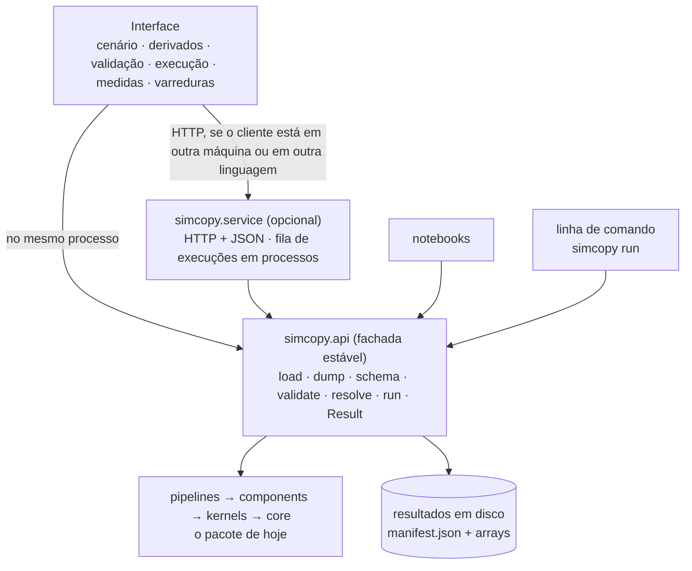

# Proposta: simcopy como API com interface

Rascunho de 2026-11-09, para discussão do grupo. É uma proposta para depois do sistema montado, não
para as 5 semanas do `docs/planejamento.md`. Mesma convenção de marcas dos guias: **[Fato: fonte]**,
**[Dedução]**, **[Proposta]**, **[Dúvida]**; **[Medido]** são números de 2026-11-09 e 2026-11-10
nesta máquina.

Parte do `docs/mapa_arquitetura.md` (citado como "mapa"), que levanta o estado do pacote e as
lacunas. "Arquitetura" é `docs/03-class/arquitetura-simulador-optico (1).md`.

Revisto em 2026-11-10, depois do comentário do Gabriel no mapa sobre dados para plotagem: vistas
escolhidas pelo domínio do sinal, `plot_io` e o módulo `plotting` (seção 2.5).

---

## Resumo

1. **O motor continua em Python.** A interface, qualquer que seja, conversa com ele por três
   fronteiras empilhadas: uma API Python (`simcopy.api`), uma linha de comando (`simcopy run`) e,
   quando houver cliente em outra máquina ou em outra linguagem, um serviço HTTP com as mesmas
   operações em JSON.
2. **A interface não tem regras próprias.** Formulários, bloqueios em cascata, derivados e
   mensagens de erro saem do esquema da configuração, do `resolve` e do `validate` que já existem.
   Por isso o que decide o custo da interface é o que o pacote expõe como dado (seção 1), e quase
   tudo isso já é necessário para montar o sistema.
3. **A primeira interface é o notebook.** Uma função de plotagem (`plot_io`, seção 2.5) por cima
   das mesmas vistas que uma tela usaria acaba com a análise repetida de hoje e fica pronta antes
   de qualquer tela.
4. **Recomendação para a primeira tela:** escrita em Python, sobre a API Python, rodando local no
   navegador (seção 4, opção A). Serve ao grupo e à disciplina sem uma segunda linguagem.
5. **Web próprio, C# ou aplicativo instalado** ficam possíveis depois sem refazer o motor, porque a
   fronteira é esquema, cenário e resultado em JSON. Eu só iria para eles com um motivo concreto:
   editor de esquemático, usuários de fora do grupo ou simulação num servidor.
6. **Reescrever o motor em C ou C++ não se justifica hoje.** O tempo da fibra está dentro da FFT,
   que já é código compilado no NumPy; o único laço em Python que pesa é o integrador do laser
   direto, de cerca de 15 linhas (mapa, 5.11).

---

## 1. O que uma interface precisa do pacote

Cada linha é algo que a interface pede e não pode inventar por conta própria.

| # | A interface precisa de | Hoje | Falta | Onde |
|---|---|---|---|---|
| 1 | Um ponto de entrada: cenário entra, resultado sai | não existe (`pipelines/` vazio) | montagem e executor | mapa 4.3 |
| 2 | Cenário que se lê e se grava, com versão | `load` só lê, escrito à mão, descarta chaves em silêncio | leitura e gravação geradas das classes; `schema_version` | mapa 5.9 |
| 3 | Esquema legível por máquina: campos, tipos, unidades, faixas, padrões, descrição, variantes | tipos nas dataclasses; unidades só em comentários | metadados por campo; exportar como JSON Schema | mapa 5.9 |
| 4 | Derivados visíveis antes de rodar | `resolve` cobre grade, canais e fibras | `resolve` dos dispositivos | mapa 5.3 |
| 5 | Erros como dado, com o campo que causou | `Violation(validator, severity, message, suggestion)`, sem campo; `ConfigError` é texto | caminho do campo e código em toda violação | mapa 4.2 |
| 6 | Identidade estável de cada bloco e ponto de medida | não existe | `id` por caminho, dado pela montagem | mapa 4.2 e 5.6 |
| 7 | Resultado que se reabre sem recalcular | não existe | resultado em disco, com proveniência | aqui 2.4 |
| 8 | Progresso e cancelamento | laços fechados em `propagate` e `integrate` | gancho no contexto | aqui 2.4 |
| 9 | Vistas reduzidas dos sinais (espectro, olho, constelação) | código repetido nos notebooks | módulo de análise | aqui 2.5 |
| 10 | Custo estimado antes de rodar | não existe | estimativa de memória e tempo a partir do `resolve` | aqui 2.3 |

**[Dedução]** A maior parte já é necessária para montar o sistema ou para tirar código repetido dos
notebooks: linhas 1, 2, 4, 5, 6, 7 e 9. São trabalho feito para a interface os metadados de exibição
do esquema (parte da linha 3), o progresso com cancelamento (8) e o custo estimado (10).

---

## 2. Arquitetura proposta



**[Proposta]** Quatro módulos novos:

- `simcopy.analysis`: funções que transformam um sinal numa vista (seção 2.5). Devolvem arrays,
  nunca figuras. Dependem só de `core`.
- `simcopy.plotting`: as figuras dos notebooks, feitas com matplotlib sobre `analysis` (o extra
  `figures` do `pyproject.toml`). Nunca importado por `components/` nem por `kernels/`.
- `simcopy.api`: a fachada, acima de `pipelines` no contrato de camadas. É o que notebooks, linha de
  comando e serviço importam. O que não está nela é interno e pode mudar (arquitetura, seção 11.4:
  `__all__` explícito, `kernels/` interno).
- `simcopy.service`: o serviço HTTP, acima de `api`, como dependência opcional
  (`pip install simcopy[service]`). O pacote base continua com `numpy`, `scipy` e `pyyaml`.

A interface fica em pasta ou repositório próprio, fora de `src/simcopy`.

### 2.1 A API Python

**[Proposta]** Esboço; os nomes são para decidir.

```python
import simcopy.api as sc

cenario  = sc.load("examples/imdd_ook_externo.yaml")
violacoes = sc.validate(cenario)             # lista; cada uma com caminho do campo e sugestao
derivados = sc.resolve(cenario)              # arvore de derivados, no formato da configuracao
resultado = sc.run(cenario, probes=["ch0.tx.mzm", "link.span0.fiber"], on_progress=print)

resultado.metrics["ch0"]["q_factor"]
resultado.view("link.span0.fiber", "spectrum", resolution=1e9)   # arrays prontos para plotar
resultado.save("runs/imdd_20km")             # sc.Result.open("runs/imdd_20km") reabre
```

`cenario` reúne `SystemConfig`, `SimulationConfig` e a versão do esquema. As quatro primeiras
chamadas correspondem a funções que já existem (`config.io.load`, `validation.rules.validate`,
`config.resolve.resolve`) ou que o `docs/planejamento.md` já prevê (montagem pela configuração).

### 2.2 O cenário como contrato

O arquivo de cenário é a fronteira entre a interface e o motor. Exemplo com campos que a
configuração já tem hoje; `schema_version` é novo, e o carregamento de canal IMDD ainda falha
(dúvida 43):

```yaml
schema_version: 1
system:
  center_frequency: 193.4e12
  channels:
    - index: 0
      kind: imdd                  # trocar para dcs troca os campos de tx e rx que existem
      modulation: OOK
      symbol_rate: 10.0e9
      seed: 1
      tx:
        frontend:
          scheme: external        # direct | external: decide se existe mzm
          laser: {power: 1.0e-3, linewidth: 500.0e3}
          mzm: {vpi: 5.0, vbias: 2.5}
      rx:
        photodiode: {responsivity: 1.0, bandwidth_factor: 1.15, filter_type: bessel, filter_order: 4}
  link:
    spans:
      - fiber: {length: 20.0e3, attenuation: 0.2e-3, dispersion: 16.0e-6}
simulation:
  samples_per_symbol: 16
  n_symbols: 128
  root_seed: 1
```

**[Fato: `config/system.py`]** `kind` e `scheme` são uniões discriminadas: um campo que não vale
para a variante escolhida não existe. **[Dedução]** Num esquema exportado isso vira "uma de N
variantes, escolhida por este campo", e um formulário gerado do esquema mostra só os campos da
variante. O bloqueio em cascata da arquitetura (seção 4.6) chega à tela sem nenhuma regra escrita na
interface.

**[Proposta]** Três regras para o contrato:

1. Unidades do SI no arquivo e no motor. A unidade de exibição (dBm, km, ps/(nm·km), GHz) é
   metadado do campo, e a conversão é da interface.
2. `schema_version` no arquivo; mudança incompatível de esquema vem com função de migração.
3. Chave desconhecida é erro, com o caminho do campo (mapa, 5.9).

### 2.3 Operações

As mesmas operações servem à API Python e, se existir, ao HTTP.

| Operação | Entrada | Saída | HTTP |
|---|---|---|---|
| esquema | nada | esquema do cenário; catálogo de blocos com portas | `GET /schema` |
| validar | cenário | violações (sem alocar arrays) | `POST /scenarios/validate` |
| resolver | cenário | derivados; estimativa de memória e de tempo | `POST /scenarios/resolve` |
| rodar | cenário, sondas pedidas | identificador da execução | `POST /runs` |
| acompanhar | identificador | estado, etapa, fração; cancelar | `GET /runs/{id}`, `DELETE /runs/{id}`, eventos |
| métricas | identificador | BER, fator Q, OSNR, potências | `GET /runs/{id}/metrics` |
| vista | identificador, sonda, tipo, parâmetros | arrays reduzidos (seção 2.5) | `GET /runs/{id}/probes/{sonda}/view` |
| varrer | cenário, parâmetro, valores | execuções e a curva da métrica | `POST /sweeps` |
| exportar | identificador | pacote reprodutível | `GET /runs/{id}/export` |

Uma violação, com os campos de hoje mais o caminho:

```json
{
  "code": "IntegerSamplesPerSymbol",
  "severity": "ERROR",
  "path": "simulation.sampling_rate",
  "message": "Canal 0: fs/Rs = 16.500000 nao e inteiro.",
  "suggestion": "[D-4] exige fs multiplo inteiro de todos os baud rates. fs = 160.00 GHz resolveria."
}
```

**Custo estimado. [Proposta]** O `resolve` já conhece N, o número de trechos e os dispositivos.
Com isso dá para estimar memória e tempo antes de rodar, estendendo o princípio de validar antes de
alocar. Referências desta máquina **[Medido]**: fibra, 0,22 µs por amostra, por polarização, por
passo; laser direto, 5,2 µs por subpasso; um campo (2, 2²²) ocupa 134 MB. O cenário de exemplo do
repositório (262 144 símbolos a 16 amostras) tem N = 2²²: dez pontos de medida guardados inteiros
passariam de 1 GB.

### 2.4 Execução e resultado

**[Proposta]**

- **Execuções em processos**, não em threads: o trabalho é NumPy, limitado por CPU. Blocos são
  dataclasses congeladas e o contexto leva só grade e semente, então uma execução vai inteira para
  outro processo (mapa, 5.13). Para um usuário, um conjunto de processos e uma tabela de execuções
  bastam; fila de verdade só com servidor para várias pessoas.
- **Progresso e cancelamento** pelo mesmo gancho no contexto, chamado pelos laços longos (trechos
  da fibra, integrador do laser, pontos de uma varredura). Serve também para a evolução ao longo de
  z (dúvida 32).
- **Estágios guardados**: numa varredura, só se refaz o que depende do parâmetro varrido. O
  transmissor não depende do comprimento da fibra (mapa, 5.11).
- **Resultado em disco**, uma pasta por execução:
  - `manifest.json`: o cenário como rodou, os derivados, as sementes, as métricas, os tempos e a
    proveniência (versão do pacote, commit, versões de NumPy e SciPy), como a arquitetura pede para
    reproduzir figura de artigo (seção 11.4).
  - um arquivo `.npy` por sonda guardada. O formato é do NumPy, não pede dependência nova e pode
    ser lido por partes (mapeado em memória), que é o que as vistas precisam.

### 2.5 Sondas e vistas

A interface nunca recebe um campo inteiro. Ela pede uma vista, e o motor reduz.

| Domínio do sinal | Vistas |
|---|---|
| bits | sequência; posições dos erros |
| símbolos | constelação; EVM |
| elétrico | forma de onda numa janela, com no máximo N pontos; diagrama de olho (histograma 2D); espectro |
| óptico | potência no tempo; chirp; espectro óptico com resolução dada; estado de polarização |

**[Fato: notebooks 01 a 07]** Essas contas já existem, espalhadas: espectro nos notebooks 01, 02,
04, 06 e 07; fase ou chirp do sinal em 01, 02 e 07; olho em 05; constelação em 03. Cada cópia repete o
cuidado da convenção de frequência (sinal do chirp, `optical_frequency`, `fftshift`). Escritas uma
vez em `simcopy.analysis`, servem aos notebooks e à interface.

Sondas são pedidas na execução (`probes=[...]`), pelo `id` do bloco. Por padrão nenhuma é guardada.

**As vistas são escolhidas pelo domínio do sinal, não pelo componente** (mapa, 5.12). Por isso
uma função só, `plot_io(entrada, saída)`, serve a todos os componentes no notebook, e uma tela só
de medidas serve a todos na interface. O que é interno a um componente e não está na entrada nem na
saída (N(t) e S(t) do laser, o campo ao longo de z na fibra) sai pelo gravador do contexto, com
nome, e entra na mesma lista de sondas.

O notebook é a primeira interface: `plot_io` usa as mesmas funções de `analysis` que o serviço
usaria. **[Medido, 2026-11-10, protótipo fora do repositório]** Quatro funções de análise e uma de
plotagem geraram os painéis de laser, fibra e fotodetector sem código específico de nenhum deles.

### 2.6 O serviço HTTP

**[Proposta]** Fino: cada rota chama uma função da API Python. Esboço:

```python
app = FastAPI()

@app.get("/schema")
def schema():
    return sc.schema()

@app.post("/scenarios/validate")
def validate(body: dict):
    return sc.validate(sc.Scenario.from_dict(body))

@app.post("/runs")
def start(body: dict):
    return {"id": execucoes.submit(sc.Scenario.from_dict(body))}
```

FastAPI publica a descrição das rotas no formato OpenAPI. A partir dela se geram clientes em
TypeScript, C# ou C++, e é isso que mantém aberta a opção de um front em outra linguagem.

Se o serviço sair da máquina do usuário, entram três coisas que hoje não são necessárias:
autenticação, limite por execução (N máximo, tempo, memória) e fila. O carregamento do cenário já
usa `yaml.safe_load` (`io.py:116`), e o cenário é só dado, sem código.

---

## 3. A interface

### 3.1 Telas

Cada tela mostra o resultado de uma operação da seção 2.3. Nenhuma faz conta de física.

| Tela | Mostra | Vem de |
|---|---|---|
| Cenário | a árvore N0 a N4 da cascata; só os campos da variante escolhida | esquema |
| Derivados | fs, N, SpS, β₂, γ, L_eff, limiar do laser, banda do receptor, custo estimado | resolver |
| Validação | violações com causa e sugestão, ao lado do campo | validar |
| Execução | etapa atual, fração, cancelar | rodar, acompanhar |
| Medidas | vistas das sondas, por domínio | vista |
| Varredura | métrica contra um parâmetro, com a forma fechada sobreposta quando ela existe | varrer |
| Exportar | cenário, pacote reprodutível, notebook equivalente | exportar |

A tela de varredura com a forma fechada sobreposta (BER contra ½erfc(Q/√2), OSNR contra as Eq.
7.4.1 e 7.4.2 do Agrawal) leva para a interface o padrão de figura que o grupo já usa: forma
fechada e simulação juntas, com o erro.

### 3.2 Dois níveis de interface

**Nível 1, formulário.** A topologia é a do cenário (canais, mux, enlace, demux, receptores) e o
usuário preenche a árvore. Depende só das operações da seção 2.3.

**Nível 2, esquemático.** O usuário arrasta blocos e liga portas, como no VPI. Depende de duas
coisas que o pacote não tem: portas declaradas em cada bloco e um formato de cenário em grafo (mapa,
5.2 e 5.8). **[Proposta]** Fica para depois do nível 1 e só se o grupo quiser; o nível 1 já cobre
o sistema, e as cadeias parciais da aula podem entrar como cenários prontos.

---

## 4. Onde a interface roda

| Opção | Linguagens a manter | Roda em | Usa o esquema e a validação | Primeira tela | Limite |
|---|---|---|---|---|---|
| A. Interface em Python (por exemplo NiceGUI, Streamlit, Panel) sobre a API Python | Python | navegador, local ou num servidor | sim, em processo | barata | editor de esquemático e interações finas são difíceis |
| B. Front web próprio em TypeScript sobre o HTTP | Python e TypeScript | navegador, local ou num servidor | sim, pelo esquema em JSON | cara | duas bases de código para um grupo de três |
| C. A ou B dentro de uma casca de desktop (pywebview, Tauri, Electron), com o Python empacotado | as de A ou de B | aplicativo instalado, sem Python na máquina de quem usa | sim | média (empacotamento) | instalador grande; atualização |
| D. Desktop nativo em Python (PySide6/Qt), sem HTTP | Python | aplicativo instalado | sim, em processo | média a cara | sem acesso remoto; muita tela escrita à mão; Qt é LGPL |
| E. Front nativo em C# (WPF, Avalonia) ou C++ (Qt) sobre o HTTP | Python e C# ou C++ | aplicativo instalado | sim, com classes geradas do OpenAPI | cara | duas linguagens; empacotar o Python junto |
| F. Site com servidor em C# (ASP.NET, Blazor) chamando o motor | Python e C# | servidor | em parte | cara | dois servidores para manter; site em C ou C++ não é usual |
| G. Motor reescrito em C ou C++ | C ou C++ | qualquer | não: refazer | muito cara | perde os notebooks e as conferências contra forma fechada |

### 4.1 Recomendação

**[Proposta]** Começar pela opção A, local.

- Uma linguagem só. Quem mantém o motor mantém a interface, o que pesa num grupo de três com
  rotatividade de alunos.
- A interface chama `simcopy.api` no mesmo processo. Não precisa do serviço HTTP para existir.
- É de nível 1 (formulário, derivados, validação, execução, medidas, varredura), que é o que a
  disciplina e o grupo usam.
- Vira aplicativo de desktop depois pela opção C, sem reescrever a tela.

Quando eu mudaria:

| Se acontecer | Então |
|---|---|
| o grupo quiser o editor de esquemático (nível 2) | opção B: canvas e arrastar blocos pedem um front próprio |
| a simulação precisar rodar num servidor do laboratório | serviço HTTP (seção 2.6) na frente da mesma API; a interface pode continuar a de A |
| houver usuários de fora, sem Python | opção C sobre A |
| houver exigência de C# ou C++ (integração com outro software do laboratório) | opção E, sobre o HTTP |

### 4.2 Onde C, C# e C++ entram

- **C e C++ no motor**: só para um laço medido como gargalo, e depois de tentar compilar o laço em
  Python (numba). Hoje o candidato é um, o integrador do laser direto (`rate_equations.py:104-116`).
  Uma extensão compilada própria tem custo de distribuição: a arquitetura conta com um pacote sem
  código compilado na v1 (seção 11.4).
- **C# ou C++ na interface**: como cliente do HTTP (opção E). O motor não muda.
- **C# no servidor** (opção F): o servidor em C# teria de chamar o Python de qualquer forma.
  Acrescenta uma camada sem tirar nenhuma.

---

## 5. O que muda no pacote desde já

São convenções baratas de adotar enquanto os blocos são escritos e caras de adotar depois. Quase
todas já estão propostas no mapa por outro motivo.

1. **Um dono para o esquema da configuração.** Leitura e gravação geradas das classes, com
   metadados por campo (unidade, unidade de exibição, faixa, descrição). Duas formas, a decidir
   (dúvida P5): pydantic v2 em `config/`, como a arquitetura recomendava (seção 4.6.1), que já
   entrega esquema, uniões discriminadas e erro com caminho; ou um leitor próprio sobre as
   dataclasses, sem dependência nova, que o grupo passa a manter.
2. **`id` por caminho em cada bloco** (mapa, 4.2), usado na semente, na sonda e no erro.
3. **Violação com caminho do campo e código.** O `validator` de hoje já serve de código.
4. **`resolve` completo**, incluindo dispositivos (mapa, 5.3). É o que a tela de derivados mostra.
5. **Gancho de progresso no contexto**, chamado pelos laços longos.
6. **Resultado com proveniência**, gravado pelo executor.
7. **Fachada `simcopy.api`** com `__all__`, e `kernels/` fora dela.
8. **`schema_version`** no cenário desde o primeiro arquivo de exemplo novo.
9. **Nada de figura dentro de blocos e kernels.** Já é regra; `analysis` devolve arrays com eixo e
   unidade, e só `plotting` importa matplotlib.
10. **Unidade explícita no sinal elétrico** (mapa, 5.5). Sem ela, nem `plot_io` nem uma tela sabem
    rotular o eixo de uma corrente ou de uma tensão.

---

## 6. Etapas

"Tamanho" é estimativa relativa (P, M, G), sem horas.

| Etapa | Entrega | Depende de | Pronto quando | Tamanho |
|---|---|---|---|---|
| 0 | Sistema IMDD montado pela configuração | mapa, seção 6 | um arquivo de cenário reproduz o notebook da cadeia IMDD sem montar nada à mão | G |
| 1 | `simcopy.api`, `simcopy run cenario.yaml -o pasta/`, resultado em disco | 0 | rodar duas vezes o mesmo arquivo dá o mesmo resultado; `Result.open` reabre sem recalcular | P |
| 2 | Esquema e erros como dado; `resolve` completo | 0 | o esquema descreve todos os campos com unidade; chave desconhecida é recusada com o caminho | M |
| 3 | `analysis` (vistas), `plotting` (`plot_io`) e `metrics` (fator Q, BER, OSNR) | blocos (mapa, seção 6) | as figuras dos notebooks de sistema saem de `plot_io`, sem FFT no notebook | M |
| 4 | Interface de nível 1 (opção A) | 1, 2, 3 | um colega monta, valida e roda o cenário IMDD sem abrir o código | M |
| 5 | Serviço HTTP | 1, 2 | o mesmo cenário roda por HTTP e devolve as mesmas métricas | M |
| 6 | Aplicativo instalado (opção C) | 4 | instala e roda numa máquina sem Python | P a M |
| 7 | Editor de esquemático (nível 2) | portas declaradas, cenário em grafo, 5 | uma cadeia da aula é montada arrastando blocos | G |

As etapas 0 a 3 são trabalho do motor e valem mesmo que a interface nunca seja feita. As etapas 5 a
7 só entram com um dos motivos da seção 4.1.

**Insumo para as issues de teste, que ficam com o grupo:** ida e volta do cenário (gravar o que
foi lido devolve o mesmo arquivo); esquema congelado em arquivo, para acusar mudança incompatível;
mesma semente, mesmo resultado; cada violação com caminho que existe no esquema.

---

## 7. Riscos

- **Interface antes do motor estável.** Enquanto a versão for 0.x a API muda. Uma interface
  escrita cedo é reescrita junto. Por isso a etapa 4 vem depois das etapas 1 a 3.
- **Tamanho dos dados.** Um campo do cenário de exemplo ocupa 134 MB **[Medido, extrapolado de
  2²⁰]**. Sondas ficam desligadas por padrão e a interface só recebe vistas.
- **Duas bases de código** nas opções B, E e F, para um grupo de três.
- **Resultado bit a bit** (critério C1 da arquitetura) vale na mesma máquina e nas mesmas versões.
  Entre máquinas, as bibliotecas de FFT podem diferir no último bit; comparação entre máquinas
  precisa de tolerância.
- **Licenças.** As ferramentas citadas nas opções A a C são de licença permissiva (MIT, BSD ou
  Apache), a conferir na versão adotada; PySide6 é LGPL. A regra de nunca importar o BIFROST (GPL)
  continua.

---

## 8. Dúvidas

**P1. Quem vai usar?** Só o grupo, os alunos da disciplina, ou gente de fora? Decide entre nível 1
e nível 2, e entre local e servidor.

**P2. Onde roda a simulação pesada?** Na máquina de cada um ou num servidor do laboratório?

**P3. A interface é objetivo do projeto ou ferramenta de apoio?** Decide se ela disputa tempo com
o sistema coerente.

**P4. Linguagem da interface.** O grupo aceita Python para o nível 1? Existe exigência de C# ou
C++ que eu não conheço?

**P5. Esquema da configuração.** pydantic v2 em `config/` (dependência nova do pacote base) ou
leitor próprio sobre as dataclasses? É a dúvida A9 do mapa.

**P6. API pública.** `kernels/` continua interno, como na arquitetura, e a API pública passa a ser
`simcopy.api`, a configuração e os blocos?

**P7. Cadeias da aula na interface.** Entram como cenários prontos (dependem da dúvida A8 do mapa)
ou só existem nos notebooks?
